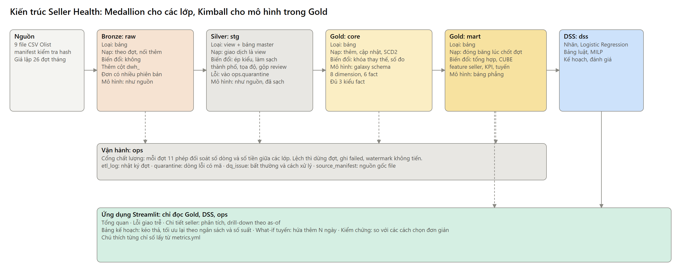

# Seller Health: Kho dữ liệu và Hệ hỗ trợ quyết định trên Olist

Bài tập lớn CO4031, học kỳ 261.

Hệ thống giúp trưởng nhóm Seller Success quyết định mỗi tháng: **gọi seller nào trước, làm gì với họ, và ngân sách thay đổi thì danh sách đổi ra sao**.

Thiết kế và báo cáo chi tiết: [docs/thiet-ke-he-thong.md](docs/thiet-ke-he-thong.md).

## Chạy bằng Docker

Cách này chạy được trên Windows, macOS và Linux, chỉ cần cài [Docker Desktop](https://www.docker.com/products/docker-desktop/) và mở nó lên trước.

```bash
git clone https://github.com/trinh-say-hi/DW_DSS.git
cd DW_DSS
docker compose up --build
```

Lần đầu mất khoảng 10–15 phút: tải Python, cài thư viện, dựng kho từ 9 CSV, chạy DSS và 130 test. Test hỏng thì build dừng. Khi thấy dòng `You can now view your Streamlit app`, mở http://localhost:8501.

Những lần sau chỉ cần `docker compose up`. Tắt bằng `Ctrl+C`. Nếu cổng 8501 đã bị dùng, đổi dòng `"8501:8501"` trong `docker-compose.yml` thành `"8502:8501"` rồi mở http://localhost:8502.

## Chạy trực tiếp trên Windows


Cần Windows, Python 3.13 và dữ liệu trong `data/olist/raw` (xem [data/README.md](data/README.md)).

```powershell
.\setup.ps1      # tạo venv ngoài OneDrive, cài thư viện, dựng kho và DSS, chạy test
.\run_app.ps1    # mở app tại http://localhost:8501
```

Dựng lại mất khoảng 2 phút và **không cần tắt app**: kho mới được dựng thành một bản phát hành riêng, qua hết kiểm tra mới được đưa vào dùng (xem mục Pipeline).

Venv và database nằm ở `%LOCALAPPDATA%\seller_health`, ngoài OneDrive, để việc đồng bộ không khóa file. Đặt `OLIST_HOME` để đổi thư mục, hoặc `OLIST_DB` để dùng cố định một file (khi đó dựng thẳng vào file đó như trước, không qua bước phát hành).

## Pipeline và điều phối (Dagster)

```powershell
.\run_pipeline.ps1                          # giao diện Dagster tại http://localhost:3000
.\run_pipeline.ps1 -Job dung_lai_toan_bo    # chạy toàn bộ, không mở giao diện
.\run_pipeline.ps1 -Job chay_lai_dss        # giữ kho, chỉ tính lại DSS, test rồi phát hành
.\run_pipeline.ps1 -Job xuat_power_bi      # chỉ xuất lại Parquet cho Power BI
python -m src.pipeline.release status       # bản đang dùng, bản trước
python -m src.pipeline.release rollback     # quay về bản trước
```

| Asset | Nhóm | Bọc bước | Kiểm tra (asset check) |
|---|---|---|---|
| `nguon_csv` | kho | đối chiếu SHA-256 với `data/manifest.json` | — |
| `kho_du_lieu` | kho | `src.etl.build`: Bronze → Silver → Gold, 26 đợt | `doi_soat_cac_lop` (**chặn**): đủ 26 đợt `ok`, mọi đối soát khớp; `bat_thuong_du_lieu` (cảnh báo) |
| `dss_khuyen_nghi` | dss | `src.dss.run`: logistic, luật, MILP, đánh giá ngược | — |
| `danh_muc_du_lieu` | dss | `src.etl.catalog`: mô tả cột, `docs/data_catalog.md` | `kiem_thu_he_thong` (**chặn**): `tests.test_system` |
| `kho_phat_hanh` | phat_hanh | trỏ `current.json` sang bản mới | — |
| `xuat_parquet` | phat_hanh | `src.pipeline.powerbi_export`: bảng Gold ra Parquet cho Power BI | — |

Các asset chỉ bọc các bước sẵn có, không viết lại logic, nên số liệu giống hệt `run_all.py`. Mỗi lần chạy dựng vào `releases/olist_run_<id>.duckdb`; check **chặn** không đạt thì các asset sau bị bỏ qua và app vẫn dùng bản cũ. App đọc `current.json` ở mỗi lần tải trang nên tự sang bản mới. Thư mục chỉ giữ bản đang dùng và bản trước. Lịch làm mới hằng ngày lúc 2 giờ sáng có sẵn nhưng mặc định tắt, bật trong giao diện Dagster.

Vì sao không ghi đè lên file cũ: app giữ file kho ở chế độ chỉ đọc, và DuckDB khóa file nên tiến trình khác không mở để ghi được. Ngoài ra, một đợt lỗi giữa chừng sẽ làm hỏng kho đang dùng.

## Hai giao diện, một kho

Cả hai giao diện đọc cùng một bản kho đã phát hành và cùng tên chỉ số trong `metrics.yml`. Không có giao diện nào gửi dữ liệu thẳng cho giao diện kia. Chúng chia nhau theo các pha ra quyết định (Simon):

| Pha | Câu hỏi | Công cụ | Người dùng |
|---|---|---|---|
| Nhận biết | Có vấn đề không, ở đâu? | Power BI: KPI tháng, OLAP drill-down, Giao hàng | Quản lý, quản lý vùng (RLS) |
| Thiết kế | Seller nào cần xử lý, vì sao? | Streamlit: Cần chú ý, Chi tiết seller, What-if tuyến | Trưởng nhóm Seller Success |
| Lựa chọn | Làm gì với ai trong ngân sách? | Streamlit: Bảng kế hoạch (MILP, kéo thả), Kiểm chứng | Trưởng nhóm Seller Success |
| Theo dõi | Kế hoạch đang xử lý bao nhiêu GMV rủi ro, ở vùng nào? | Power BI: Theo dõi kế hoạch | Quản lý, quản lý vùng (RLS) |

Power BI không thay được Streamlit: nó không giải được MILP, không ghi lại quyết định và không chạy trong Docker. Streamlit không thay được Power BI: nó không có OLAP server (VertiPaq) và không có phân quyền theo dòng. Hai giao diện dùng chung tông hồng trắng.

## Lớp Power BI (OLAP server, RLS)

Mô hình Tabular nạp vào VertiPaq, có quan hệ star, measure DAX, hierarchy để drill và phân quyền theo dòng (RLS). Báo cáo có 4 trang, đều khóa khoảng 01/2017 – 08/2018 (trừ trang kế hoạch), lọc theo cây Năm → Tháng và ghi rõ "Kỳ đang xem": **KPI tháng** (số chốt sổ), **Doanh số dồn ở đâu?** (cây phân rã vùng → bang → danh mục → hạng, tán xạ danh mục GMV × trễ), **Giao hàng** (trễ do seller hay do vận chuyển), **Kế hoạch đề xuất** (bấm một mốc trên đường để xem kế hoạch của mốc đó, kế hoạch theo vùng, seller theo hạng, danh sách seller trong kế hoạch).

```powershell
.\run_pipeline.ps1 -Job xuat_power_bi      # chỉ xuất lại Parquet từ bản đang dùng
python -m src.pipeline.powerbi_export      # như trên, không qua Dagster
```

Sau đó mở `powerbi/OlistSellerHealth.pbip` bằng Power BI Desktop rồi bấm **Refresh**. Asset `xuat_parquet` chạy sau `kho_phat_hanh`, nên job `dung_lai_toan_bo` và `chay_lai_dss` cũng tự xuất lại. Parquet nằm ở `%LOCALAPPDATA%\seller_health\powerbi\`, kèm `manifest.json` ghi bản phát hành và số dòng. Máy khác thì đổi tham số `ThuMucParquet` (Transform data > Edit parameters).

| Thành phần | Nội dung |
|---|---|
| Bảng | 7 dimension (`dim_date`, `dim_region`, `dim_seller` SCD2, `dim_product`, `dim_location`, `dim_route`, `dim_seller_health`), 3 fact (`fact_sales_item`, `fact_order_seller`, `fact_seller_monthly`), bảng tổng hợp `kpi_monthly` và `dss_recommendation` |
| Quan hệ | 19 quan hệ một-nhiều, lọc một chiều. `dim_date` nhiều vai: ngày mua đang hoạt động; ngày hẹn và ngày nhận là quan hệ không hoạt động, measure bật bằng `USERELATIONSHIP` |
| Hierarchy | Lịch (năm → quý → tháng → ngày), Địa lý seller và Địa lý khách (vùng → bang → thành phố), Sản phẩm (danh mục → sản phẩm) |
| Measure | 32 measure dịch từ `metrics.yml`, chia thư mục: KPI tháng (chốt sổ), OLAP bán hàng, Giao hàng và review, Sức khỏe seller, DSS |
| RLS | Role **Quản lý vùng Sudeste**: `dim_region[region] = "Sudeste"`, lan qua `dim_seller` tới mọi fact theo seller và qua `kpi_monthly` |
| What-if | Bảng tham số **Hiệu quả can thiệp** vẫn có trong mô hình nhưng không đặt lên báo cáo: what-if nằm ở Streamlit |

Hai nhóm KPI có chủ ý tách nhau:

- **KPI tháng (chốt sổ)** đọc `mart.kpi_monthly`, là số biết được tại lúc chốt từng tháng. Nếu tính lại từ fact cuối cùng thì review lệch nhẹ, vì điểm review còn đổi sau ngày chốt. Khi có lọc vùng, danh mục, hoặc khi RLS ẩn dòng tổng, measure tự chuyển từ dòng tổng của CUBE sang cộng các dòng chi tiết. Review TB và Seller có bán không cộng được qua nhiều tháng, nên chỉ hiện khi lát cắt đúng một dòng.
- **OLAP** tính trên fact theo trạng thái cuối của kho (as-of = ngày chốt đợt cuối), cùng định nghĩa với màn OLAP của Streamlit.

MOLAP, ROLAP và HOLAP trên mô hình này: chế độ Import hiện tại là MOLAP (dữ liệu nén cột trong VertiPaq). Đổi partition sang DirectQuery thì thành ROLAP, truy vấn đẩy xuống nguồn. Chế độ Dual hoặc bảng aggregation Import đặt trên fact DirectQuery là HOLAP. `kpi_monthly` chính là một bảng aggregation dựng sẵn bằng CUBE ở kho.

Đối chiếu với DuckDB (chạy DAX qua Power BI Modeling MCP trên Desktop): mỗi tháng của GMV, số đơn, seller có bán, đơn đến hạn, đơn trễ, tỷ lệ trễ và review trung bình đều khớp `mart.kpi_monthly`. Các measure OLAP khớp truy vấn của màn OLAP. Cả hai được kiểm cho toàn sàn và dưới role Sudeste.

## Kiến trúc

Medallion cho các lớp, Kimball cho mô hình trong Gold.



| Lớp | Schema | Vai trò |
|---|---|---|
| Bronze | `raw` | Dữ liệu gốc dạng chữ, thêm cột `dwh_`; đơn hàng có nhiều phiên bản |
| Silver | `stg` | Ép kiểu, sửa tên thành phố, lọc tọa độ, gộp review. Giao dịch là view, master là bảng |
| Gold | `core` | Galaxy schema: 8 dimension, 6 fact |
| Gold | `mart` | Chốt cuối mỗi đợt: feature seller, KPI bằng CUBE, thống kê tuyến |
| | `dss` | Nhãn, điểm rủi ro, kế hoạch tối ưu, kết quả đánh giá |
| | `ops` | Nhật ký, cách ly, đối soát, nguồn gốc |

CSV chỉ có trạng thái cuối của đơn. Vì vậy mỗi đợt che đi các mốc chưa xảy ra trước ngày chốt, và feature được tính ngay lúc chốt đợt, khi kho chưa có dữ liệu tương lai. Mỗi đợt có 11 phép đối soát số dòng và số tiền giữa các lớp; lệch thì dừng đợt.

## Mô hình dữ liệu

| Bảng | Loại | Grain |
|---|---|---|
| `dim_date` | Dimension, nhiều vai trò | 1 ngày |
| `dim_seller` | Dimension, SCD Type 2 theo hạng ổn định | 1 phiên bản của seller |
| `dim_seller_health` | Mini-dimension | 1 tổ hợp hồ sơ sức khỏe |
| `dim_customer` | Dimension | 1 `customer_unique_id` |
| `dim_product` | Dimension | 1 sản phẩm |
| `dim_location` | Dimension | 1 ZIP |
| `dim_route` | Dimension | 1 cặp bang seller → bang khách |
| `dim_order_status` | Dimension | 1 trạng thái |
| `fact_sales_item` | Transaction | 1 sản phẩm trong 1 đơn |
| `fact_order` | Accumulating snapshot | 1 đơn |
| `fact_order_seller` | Accumulating snapshot | 1 đơn × 1 seller |
| `fact_review` | Transaction | 1 review × 1 đơn |
| `fact_payment` | Transaction | 1 lần thanh toán |
| `fact_seller_monthly` | Periodic snapshot | 1 seller × 1 tháng |

Tài liệu: [thiết kế và báo cáo](docs/thiet-ke-he-thong.md) · [data catalog](docs/data_catalog.md) · [quy tắc đặt tên](docs/naming_conventions.md) · [yêu cầu](docs/requirements.md) · [định nghĩa KPI](metrics.yml) · [truy vấn OLAP](src/sql/olap_examples.sql).

## Năm màn hình Streamlit, hai luồng quyết định

Mỗi màn hình vừa khung 1440 × 800, không phải cuộn. Cửa sổ khác cỡ thì bố cục tự dàn theo chiều rộng thật và chữ co nhẹ theo bề ngang, nên biểu đồ luôn lấp kín ô; cửa sổ thấp hơn 800 thì cuộn dọc. Danh sách màn hình nằm ở sidebar bên trái, mặc định thu gọn, bấm » ở góc trên để mở.

| Màn hình | Câu hỏi được trả lời | Quyết định rút ra |
|---|---|---|
| 1 · Cần chú ý tháng này | Seller nào vừa rơi vào Nguy cơ, vì sao chưa được xử lý? | Mở hồ sơ seller nào trước (bấm dòng) |
| 2 · Chi tiết seller | Seller này sụt ở đâu, lỗi ở khâu seller hay vận chuyển? | Hỗ trợ seller hay chuyển sang luồng giao nhận |
| 3 · Bảng kế hoạch | Với ngân sách và số suất này thì làm gì với ai? (kéo thả, kịch bản, khoảng P10–P90) | Danh sách hành động, xuất CSV |
| 4 · Kiểm chứng | Các tháng trước danh sách trúng bao nhiêu, kế hoạch đổi bao nhiêu khi giả định đổi? | Có nên tin hệ thống không |
| What-if hẹn giao (luồng giao nhận) | Hứa thêm N ngày trên tuyến thì tỷ lệ trễ còn bao nhiêu? | Có đổi lời hẹn không (Quản lý vận hành) |

Màn Tổng quan, Lỗi giao trễ và Đa chiều (OLAP) cũ vẫn còn trong `src/app/` nhưng không còn trên menu: phần theo dõi KPI, OLAP và giao hàng đã chuyển sang Power BI.

## Thành phần DSS

| Thành phần | Cách làm | Mã nguồn |
|---|---|---|
| Rủi ro sụt GMV và tạm ngừng 45 ngày | Logistic Regression, train cuốn theo thời gian, cách test ít nhất 45 ngày | `src/dss/run.py` |
| Điểm vận hành | Công thức có trọng số | `src/dss/run.py` |
| Bảng luật và lý do bằng chữ | Luật theo rủi ro, giá trị, vận hành | `src/dss/rules.py` |
| Tối ưu kế hoạch | MILP: mỗi seller tối đa 1 hành động, giới hạn ngân sách và số suất | `src/dss/optimize.py` |
| What-if | Tính lại kế hoạch, tính lại tỷ lệ trễ trên đơn lịch sử | `src/app/screens_dss.py` |
| Mô phỏng Monte Carlo | Seller sụt hay không theo khả năng sụt, hiệu quả rút quanh giả định ± độ bất định; ra khoảng P10–P90 của GMV giữ được | `src/dss/simulate.py` |

Ngưỡng rủi ro và ngân sách mặc định được chọn trên 09/2017–02/2018 (`scripts/tune_threshold.py`). Các tháng 03–07/2018 chỉ dùng để báo cáo kết quả.

## Kết quả (03–07/2018, cùng số seller, khoảng 30 mỗi tháng)

| Cách chọn | Gọi trúng seller thật sự sụt GMV | Phần GMV mất nằm trong danh sách |
|---|---|---|
| Kế hoạch DSS | 44–64%, trung bình 55% | 16–26%, trung bình 19% |
| Chọn theo GMV cao nhất | 21–31%, trung bình 26% | 16–31%, trung bình 25% |

Hệ thống gọi trúng nhiều hơn, nhưng bao phủ ít tiền hơn ở 4/5 tháng, vì seller rất lớn có xác suất sụt thấp. Mô hình chỉ nhỉnh hơn cách đơn giản: AUC dự báo tạm ngừng là 0,80–0,84, so với 0,77–0,80 khi chỉ dùng số ngày không bán; AUC dự báo sụt GMV là 0,67–0,73, so với 0,66–0,73.

## Hạn chế

- Việc nạp theo tháng là giả lập từ một bản CSV cuối cùng. Không có thời điểm hủy đơn, nên đơn hủy hiện trạng thái hủy ngay từ đợt của tháng mua.
- Đợt nạp lỗi không có rollback tự động, vì DuckDB 2.0 crash khi `COMMIT` giao dịch lớn. Hệ thống dừng, ghi `failed`, không tiến watermark, và chạy lại được an toàn.
- Không có dữ liệu về hiệu quả can thiệp. Chi phí và hiệu quả là giả định; "Giữ được" không phải số đã đo.
- "Gọi trúng" chỉ cho biết seller có sụt thật, không chứng minh can thiệp sẽ giữ được họ.
- Hạng do hệ thống tính ra, vì nguồn không có lịch sử thay đổi của seller. Hạng ổn định vẫn đổi ở 20% lượt chuyển tháng, hạng tháng ở 49% (seller từ 6 đơn trở lên, 01–07/2018).
- Xác suất mô hình chưa được hiệu chỉnh, nên dùng để xếp thứ tự hơn là đọc như tỷ lệ chính xác.
- Bản đồ dùng tọa độ trung bình theo bang, không có nền bản đồ và không phải khoảng cách đường bộ.
- Chỉ dùng một nguồn; bộ Marketing Funnel chưa được tích hợp.

## Kiểm thử

```powershell
python -m tests.test_system   # nguồn, các lớp, đối soát, chống rò rỉ, tối ưu, cổng chất lượng
python -m tests.test_edges    # mọi màn hình trên mọi mốc as-of
python -m tests.test_ui       # trình duyệt thật: cần chạy app ở cổng 8599 và cài requirements-dev.txt
python -m tests.test_release  # bản phát hành: phát hành khi app đang mở, dọn dẹp, quay lui
```

Kết quả được ghi vào `evidence/`, kèm ảnh chụp giao diện trong `evidence/screenshots/`.

## Cấu trúc thư mục

```
src/etl/      điều phối các đợt nạp, kiểm tra nguồn, sinh data catalog
src/pipeline/ Dagster (asset, asset check, job, lịch) và quản lý bản phát hành kho
src/sql/      schema, staging, dimension, từng đợt, đối soát, truy vấn OLAP
src/dss/      điểm số, luật, tối ưu
src/app/      giao diện Streamlit, component kéo thả tự viết
powerbi/      Power BI Project (PBIP): mô hình TMDL, 3 trang báo cáo PBIR
tests/        kiểm thử
scripts/      manifest, sơ đồ, thử khả thi, chọn ngưỡng, dữ liệu mẫu
evidence/     số liệu và hình cho báo cáo
data/         dữ liệu nguồn, mẫu, manifest
docs/         thiết kế, data catalog, quy tắc đặt tên, yêu cầu, sơ đồ
catalog.yml   mô tả bảng và cột
metrics.yml   định nghĩa KPI
```

## Báo cáo

Báo cáo PDF nằm ở `report/BaoCao_SellerHealth_CO4031.pdf`, nội dung ở `report/bao_cao.html`. Mọi biểu đồ được vẽ lại từ kho và từ `evidence/`, không gõ tay số liệu. Sau khi sửa nội dung hoặc dựng lại kho:

```powershell
python report/make_figures.py   # vẽ lại biểu đồ SVG từ kho
python report/build_pdf.py      # xuất PDF bằng Edge và Paged.js (cần playwright trong requirements-dev.txt)
```

Ô tô vàng trên bìa và ở Phụ lục A là thông tin nhóm cần điền: số nhóm, MSSV, thành viên, link video, phân công.
