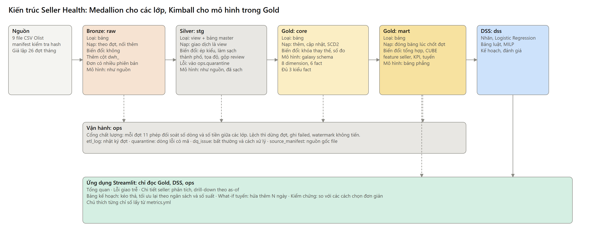
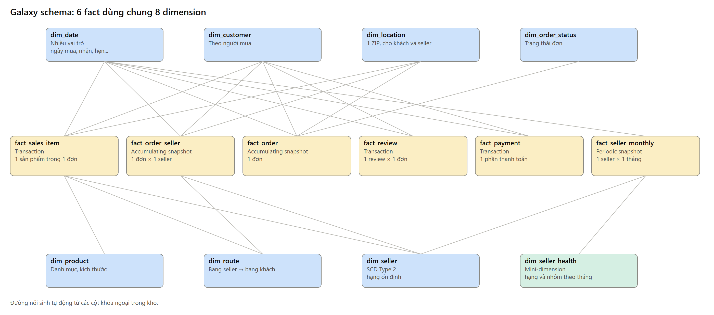
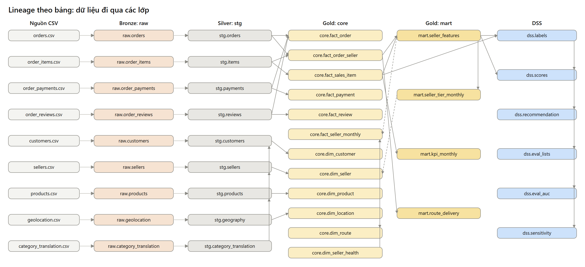

# Seller Health: Thiết kế và báo cáo kỹ thuật toàn hệ thống

Kho dữ liệu và hệ hỗ trợ quyết định chăm sóc người bán trên Olist. Bài tập lớn CO4031, học kỳ 261.

Mọi con số trong tài liệu được lấy từ kho đã dựng ngày 07/11/2026, sau khi nâng cấp, trừ khi ghi khác.

**Cách đọc:** mục 0 giải thích thuật ngữ. Mục 1–2 cho biết hệ thống làm gì. Mục 3–7 giải thích cách làm từng phần, trong đó mục 7 mô tả từng trường trên giao diện. Mục 8–10 là kết quả và giới hạn. Mục 11–13 phục vụ việc viết báo cáo, thuyết trình và chạy lại. Mục 14 gom toàn bộ công thức.

---

**Mục lục:** [0. Thuật ngữ](#0-thuật-ngữ) · [1. Tóm tắt](#1-tóm-tắt) · [2. Kiến trúc](#2-kiến-trúc-tổng-thể) · [3. Dữ liệu nguồn](#3-dữ-liệu-nguồn) · [4. ELT](#4-elt-dữ-liệu-đi-vào-kho-thế-nào) · [5. Thiết kế kho](#5-thiết-kế-kho-dữ-liệu) · [6. DSS](#6-thiết-kế-dss) · [7. Giao diện từng trường](#7-giao-diện-từng-màn-hình-và-từng-trường) · [8. Đánh giá](#8-đánh-giá) · [9. Kiểm thử](#9-kiểm-thử) · [10. Hạn chế](#10-hạn-chế-và-hướng-phát-triển) · [11. Đối chiếu đề](#11-đối-chiếu-với-đề-bài) · [12. Câu hỏi](#12-câu-hỏi-giảng-viên-có-thể-hỏi) · [13. Vận hành](#13-vận-hành-và-mã-nguồn) · [14. Toàn bộ công thức](#14-toàn-bộ-công-thức)

---

## 0. Thuật ngữ

### Nghiệp vụ

| Thuật ngữ | Nghĩa trong hệ thống này |
|---|---|
| **Olist** | Nền tảng giúp shop nhỏ ở Brazil bán lên nhiều sàn lớn |
| **Seller** | Người bán trên Olist, là đối tượng của mọi quyết định |
| **Seller Success** | Đội chăm sóc người bán, là người dùng của hệ thống |
| **GMV** (Gross Merchandise Value) | Tổng tiền hàng bán ra. Ở đây là tổng `price` của các đơn không bị hủy, chưa gồm phí vận chuyển |
| **BRL** | Real Brazil, đơn vị tiền |
| **Đơn hợp lệ** | Đơn có trạng thái khác `canceled` và `unavailable` |
| **Giao vận chuyển** | Seller bàn giao hàng cho hãng vận chuyển, ghi trong `order_delivered_carrier_date` |
| **Hạn giao vận chuyển** | Hạn seller phải bàn giao, tức `shipping_limit_date` của nguồn |
| **Ngày hẹn** | Ngày giao dự kiến báo cho khách, tức `order_estimated_delivery_date` |
| **Seller trễ** (`seller_late`) | Bàn giao sau hạn. Đây là lỗi ở khâu của seller |
| **Khách nhận trễ** (`customer_late`) | Khách nhận sau ngày hẹn, so theo ngày. Đây là kết quả khách cảm nhận, lỗi có thể ở bất kỳ khâu nào |
| **Tuyến** | Cặp bang seller → bang khách, ví dụ `SP->RJ`. Không phải một lộ trình xe cụ thể |
| **Churn** | Rời bỏ hẳn. Hệ thống **không** dùng từ này cho nhãn, vì nhiều seller quay lại |
| **Tạm ngừng** (`dormant`) | Không có GMV trong 45 ngày tới |
| **Sụt GMV** (`decline`) | GMV 45 ngày tới thấp hơn một nửa mức bình thường |
| **Gọi trúng** | Seller được chọn thật sự sụt GMV ở 45 ngày sau. Không có nghĩa can thiệp đã thành công |

### Kho dữ liệu

| Thuật ngữ | Nghĩa |
|---|---|
| **DW** (Data Warehouse) | Kho dữ liệu tích hợp, phục vụ phân tích, có lịch sử theo thời gian |
| **ETL / ELT** | Trích xuất, biến đổi, nạp, khác nhau ở thứ tự. Hệ thống này là **ELT**, xem [mục 2](#etl-hay-elt) |
| **Lớp raw, staging, core, mart** | Dữ liệu gốc → đã làm sạch → mô hình đa chiều → tổng hợp sẵn cho người dùng |
| **Medallion** | Cách chia lớp Bronze, Silver, Gold. Ở đây `raw` là Bronze, `stg` là Silver, `core` + `mart` là Gold. Medallion chia lớp, còn mô hình trong Gold vẫn theo Kimball |
| **Cách ly** (quarantine) | Dòng không hợp lệ được giữ riêng, có mã lỗi, không đi tiếp vào Gold |
| **Cổng chất lượng** | Đối soát giữa các lớp ngay trong lúc nạp. Lệch thì dừng đợt |
| **Manifest nguồn** | File ghi hash và số dòng của từng file nguồn, dùng để phát hiện dữ liệu bị đổi |
| **Batch / đợt nạp** | Một lần nạp dữ liệu. Ở đây mỗi tháng là một đợt |
| **Ngày chốt** (`c`) | Mốc kết thúc một đợt, là ngày đầu tháng kế tiếp. Kho không thấy gì từ ngày này trở đi |
| **Watermark** | Mốc đánh dấu đã nạp tới đâu, lưu trong `ops.etl_log` |
| **Nạp tăng dần** | Mỗi đợt chỉ xử lý phần mới |
| **Idempotent** | Chạy lại cùng một đợt không tạo dòng trùng |
| **Grain** | Một dòng của bảng đại diện cho cái gì |
| **Fact / Dimension** | Bảng số đo / bảng ngữ cảnh (ai, ở đâu, khi nào, cái gì) |
| **Transaction fact** | Mỗi dòng là một sự kiện, không đổi sau khi ghi |
| **Accumulating snapshot** | Mỗi dòng theo dõi một quy trình, được cập nhật dần các mốc |
| **Periodic snapshot** | Chụp trạng thái theo chu kỳ, ở đây là tháng |
| **Star / galaxy schema** | Một fact với các dimension / nhiều fact dùng chung dimension |
| **Bus matrix** | Bảng cho biết fact nào dùng dimension nào |
| **Surrogate key** | Khóa do kho tự sinh, như `seller_key`. Một seller có thể có nhiều khóa này |
| **Natural key** | Khóa từ nguồn, như `seller_id` |
| **SCD Type 2** | Lưu lịch sử bằng cách thêm dòng mới có thời gian hiệu lực, không ghi đè |
| **Mini-dimension** | Tách thuộc tính thay đổi nhanh ra một dimension nhỏ, tránh làm dimension chính phình to |
| **Hạng tháng / hạng ổn định** | Hạng tính lại mỗi tháng / hạng trong `dim_seller`, chỉ đổi khi hạng tháng giữ nguyên 2 kỳ |
| **Role-playing dimension** | Một dimension dùng cho nhiều vai trò. `dim_date` là ngày mua, ngày duyệt, ngày nhận... |
| **Unknown member** | Dòng `-1` đại diện cho giá trị không rõ |
| **OLAP** | Phân tích đa chiều: roll-up gộp lên, drill-down đi sâu, slice cắt theo một chiều, dice lọc theo nhiều chiều, pivot xoay trục |
| **CUBE / ROLLUP** | Lệnh SQL tính sẵn tổng theo mọi tổ hợp chiều / theo cấp bậc |

### DSS và mô hình

| Thuật ngữ | Nghĩa |
|---|---|
| **DSS** | Hệ hỗ trợ quyết định: đưa ra phương án và bằng chứng, người dùng quyết định |
| **As-of** | "Hôm nay" giả lập. Hệ thống chỉ thấy dữ liệu trước ngày này |
| **Feature** | Biến đầu vào của mô hình |
| **Nhãn** (label) | Đáp án đúng để mô hình học, biết được khi nhìn lại quá khứ |
| **Rò rỉ dữ liệu** (data leakage) | Dùng nhầm thông tin chưa có tại thời điểm dự báo |
| **Train / test** | Phần dữ liệu để học / để kiểm tra |
| **Train cuốn** | Mỗi mốc test chỉ học từ các mốc đã có đủ nhãn trước đó |
| **Backtest** | Đứng ở một mốc quá khứ, dự báo, rồi so với thực tế |
| **Logistic Regression** | Mô hình cho ra xác suất từ tổng có trọng số của các feature |
| **Hệ số** | Trọng số của feature. Dương là làm tăng rủi ro, tính trên feature đã chuẩn hóa |
| **AUC** | Xác suất mô hình chấm một ca dương cao hơn một ca âm. 0,5 là đoán bừa, 1 là hoàn hảo |
| **Baseline** | Cách đơn giản để so sánh |
| **Hiệu chỉnh xác suất** | Làm cho "97%" thật sự xảy ra 97% số lần. Hệ thống **chưa** làm việc này |
| **Bảng luật** | Các điều kiện nếu–thì, cho ra phân khúc |
| **Phân khúc** (segment) | Nhóm theo rủi ro, giá trị, vận hành |
| **Hành động** (action) | `CALL` gọi ngay, `OPS` hỗ trợ vận hành, `EMAIL` email tự động, `NONE` chưa xử lý |
| **Suất** | Đơn vị công sức nhân viên. Gọi dùng 1 suất, hỗ trợ dùng 2 suất |
| **Knapsack / MILP** | Bài toán cái túi: chọn tập lợi ích lớn nhất trong giới hạn / cách giải bằng quy hoạch tuyến tính nguyên |
| **What-if** | Đổi tham số để xem kết quả đổi ra sao |
| **Độ nhạy** | Danh sách thay đổi bao nhiêu khi giả định thay đổi |
| **Jaccard** | Mức trùng của hai danh sách, từ 0 đến 100% |
| **Bốn pha của Simon** | Intelligence phát hiện vấn đề, Design tạo phương án, Choice chọn, Implementation thực hiện |

Ký hiệu rút gọn trên giao diện: **VH kém** là vận hành kém, **VC** là vận chuyển, **TB** là trung bình.

---

## 1. Tóm tắt

**Người dùng:** trưởng nhóm Seller Success của Olist. Đây là vai trò giả định cho đồ án, chưa phỏng vấn người thật. Mỗi tháng người này có ngân sách và số nhân viên giới hạn, trong khi có khoảng 1.300–1.650 seller đang hoạt động.

**Ba quyết định hệ thống hỗ trợ:**

1. Gọi seller nào trước?
2. Làm gì với seller đó: gọi giữ chân, hỗ trợ vận hành, email tự động, hay chưa xử lý?
3. Khi ngân sách hoặc nhân sự đổi, danh sách đổi thế nào? Có đáng chi thêm không?

**Hệ thống gồm:**

- Kho dữ liệu DuckDB dựng từ 9 file CSV Olist, nạp giả lập 26 đợt theo tháng.
- Lớp DSS gồm mô hình dự báo, bảng luật và bộ tối ưu.
- Ứng dụng Streamlit 6 màn hình, có bảng kế hoạch kéo thả.

**Lần nâng cấp 07/11/2026:** làm sạch Silver, thêm `fact_order`, `fact_review`, `dim_location`, mini-dimension, cổng chất lượng, data catalog, và giao diện vừa một khung hình. Kết quả DSS gần như không đổi.

**Kết quả chính (03–07/2018, các tháng không dùng để chọn tham số):**

- Cùng số seller, kế hoạch DSS gọi trúng seller thật sự sụt GMV **44–64%**, so với **21–31%** khi chọn theo GMV cao nhất.
- Đổi lại, kế hoạch bao phủ ít GMV mất hơn ở 4/5 tháng: trung bình **19%** so với **25%**.
- Giá trị lớn nhất nằm ở việc chọn đúng hành động: **72%** đơn trễ trên toàn bộ dữ liệu có seller vẫn giao vận chuyển đúng hạn, nên phạt theo tỷ lệ trễ tổng sẽ phạt oan nhiều seller.

**Điều hệ thống không chứng minh được:** can thiệp có giữ được seller hay không, vì dữ liệu không có nhóm đối chứng hay hiệu quả can thiệp thật.

---

## 2. Kiến trúc tổng thể

```
 9 file CSV Olist (Kaggle)
        │
        │  Extract + Load: mỗi đợt tháng (che các mốc chưa xảy ra trước ngày chốt)
        ▼
┌─ KHO DỮ LIỆU (DuckDB) ──────────────────────────────────────────┐
│                                                                  │
│  src    view đọc CSV                                             │
│   ▼                                                              │
│  raw    Bronze: dữ liệu gốc dạng chữ + các cột dwh_              │
│         raw.orders giữ nhiều phiên bản của một đơn               │
│   ▼                                                              │
│  stg    Silver: Transform bắt đầu từ đây, bằng SQL trong kho:    │
│         ép kiểu, sửa tên thành phố, lọc tọa độ, gộp review       │
│   ▼                                                              │
│  core   Gold: 8 dimension + 6 fact (galaxy schema)               │
│   ▼                                                              │
│  mart   Gold: chốt cuối mỗi đợt: feature, KPI CUBE, tuyến        │
│                                                                  │
│  ops    etl_log, quarantine, dq_issue, layer_reconciliation      │
└───────────────┬──────────────────────────────────────────────────┘
                │ đọc mart + core
                ▼
┌─ DSS (Python) ───────────────────────────────────────────────────┐
│  Nhãn (nhìn lại quá khứ) → Logistic Regression train cuốn        │
│        → p_decline, p_dormant                                    │
│  Bảng luật → phân khúc, lý do bằng chữ                           │
│  Tối ưu MILP → ai được gọi, ai được hỗ trợ                       │
│  Đánh giá → so với các cách chọn đơn giản                        │
└───────────────┬──────────────────────────────────────────────────┘
                │ ghi vào schema dss trong kho
                ▼
┌─ ỨNG DỤNG (Streamlit, chỉ đọc kho) ──────────────────────────────┐
│  Tổng quan │ Lỗi giao trễ │ Chi tiết seller                      │
│  Bảng kế hoạch (kéo thả) │ What-if tuyến │ Kiểm chứng            │
│  Bộ tối ưu chạy lại ngay khi người dùng đổi tham số              │
└──────────────────────────────────────────────────────────────────┘
```

Bản hình: `docs/diagrams/01_kien_truc.png` (kiến trúc), `02_lineage.png` (lineage theo bảng), `03_galaxy_schema.png`, `04_luong_dss.png`.



### Công nghệ và lý do chọn

| Thành phần | Chọn | Lý do | Cái giá phải trả |
|---|---|---|---|
| Kho dữ liệu | DuckDB 2.0 | Dạng cột, hỗ trợ CUBE và ROLLUP, chỉ một file, không cần cài server | Một tiến trình ghi tại một thời điểm, không phải hệ quản trị dạng server |
| Biến đổi | SQL chạy theo thứ tự, Python điều phối | Dễ đọc, truy vết được, không thêm công cụ | Không có sơ đồ phụ thuộc tự động như dbt |
| Mô hình | Logistic Regression (scikit-learn) | Giải thích được; bản thử cho thấy Random Forest không hơn rõ rệt | Chỉ nắm được quan hệ tuyến tính |
| Tối ưu | MILP qua `scipy.optimize.milp` (HiGHS) | Có sẵn trong SciPy, giải chính xác | |
| Giao diện | Streamlit, Plotly, component kéo thả tự viết bằng SortableJS | Nhanh, viết bằng Python; thư viện kéo thả có sẵn bị crash khi cột có thanh cuộn | Phải tự duy trì component |
| Chạy ở đâu | Local | Dữ liệu nhỏ, cần database lưu lâu dài và app chạy liên tục, điều Kaggle notebook không phù hợp | |

Venv và database đặt ở `%LOCALAPPDATA%\seller_health`, ngoài OneDrive, để việc đồng bộ không khóa file.

### ETL hay ELT?

**Hệ thống này là ELT.** Khác biệt nằm ở chỗ biến đổi diễn ra ở đâu:

| | ETL | ELT (hệ thống này) |
|---|---|---|
| Thứ tự | Extract → Transform → Load | Extract → Load → Transform |
| Biến đổi ở đâu | Công cụ riêng, trước khi vào kho (ví dụ Pentaho) | Ngay trong kho, bằng SQL |
| Dữ liệu gốc | Thường không giữ lại trong kho | Giữ nguyên ở lớp `raw` |
| Khi đổi logic | Thường phải trích xuất lại | Chạy lại phần biến đổi |

| Bước | Trong hệ thống | File |
|---|---|---|
| **Extract** | Đọc 9 CSV thành view `src.*` | `src/etl/build.py` |
| **Load** | Chép nguyên văn dạng chữ vào `raw.*`, thêm các cột `dwh_` | `10_batch_raw.sql` |
| **Transform** | `raw → stg → core → mart`, toàn bộ bằng SQL trong DuckDB | `01_staging.sql`, `02_dimensions.sql`, `11_batch_core.sql`, `12_batch_close.sql` |

Ba điểm dễ bị hỏi:

- **Đề ghi "ETL":** đề dùng từ ETL theo nghĩa chung cho quy trình đưa dữ liệu vào kho. Báo cáo nên viết: "Nhóm hiện thực quy trình ETL theo biến thể ELT", kèm lý do.
- **Thư mục `src/etl/`:** tên thư mục giữ theo thói quen, bên trong là ELT.
- **Bước che các mốc tương lai** chạy trước khi nạp vào `raw`, nhưng đó **không** phải biến đổi của ELT. Nó chỉ giả lập nguồn gửi dữ liệu theo tháng. Nếu có nguồn thật thì bước này bị bỏ đi, còn phần sau giữ nguyên.

**Vì sao chọn ELT:** dữ liệu vừa phải nên DuckDB xử lý tốt, không cần công cụ riêng. Giữ `raw` nên đổi định nghĩa, ví dụ đổi ngưỡng hạng, chỉ cần chạy lại phần biến đổi. SQL cũng dễ truy vết và kiểm thử.

---

## 3. Dữ liệu nguồn

Nguồn: [Brazilian E-Commerce Public Dataset by Olist](https://www.kaggle.com/datasets/olistbr/brazilian-ecommerce). Đơn hàng thật đã ẩn danh, mua từ 09/2016 đến 10/2018.

| File | Số dòng | Grain |
|---|---:|---|
| orders | 99.441 | 1 đơn |
| order_items | 112.650 | 1 sản phẩm trong 1 đơn |
| order_payments | 103.886 | 1 phần thanh toán |
| order_reviews | 99.224 | 1 review |
| customers | 99.441 | 1 `customer_id`, tức 1 đơn; 96.096 khách thật theo `customer_unique_id` |
| sellers | 3.095 | 1 seller |
| products | 32.951 | 1 sản phẩm |
| geolocation | 1.000.163 | 1 tọa độ quan sát; 19.015 ZIP |
| category_translation | 71 | 1 danh mục |

**Giai đoạn dùng được:** từ 01/2017 đến 08/2018. Từ 09/2018 gần như chỉ còn đơn hủy, nên mốc as-of cuối có nhãn là 01/07/2018 và mốc hiện tại cuối là 01/09/2018.

### Làm sạch ở lớp Silver

| Vấn đề | Bằng chứng | Cách xử lý |
|---|---|---|
| Tên thành phố seller bẩn | `04482255`, `sao paulo / sao paulo`, `sao pauo`, `vendas@creditparts.com.br`, `sp` | Chuẩn hóa: bỏ dấu, bỏ phần sau dấu phân cách, bỏ mã bang cuối. Không có trong danh sách tên hợp lệ thì lấy theo ZIP. 41 seller được sửa theo ZIP. Tên gốc giữ ở `city_raw` |
| Tên thành phố geolocation chưa thống nhất | 8.011 tên khác nhau, còn 5.969 sau khi bỏ dấu | Bỏ dấu trước khi lấy tên xuất hiện nhiều nhất |
| Tọa độ ngoài Brazil | 42 dòng, làm sai trung vị của 8 ZIP | Đưa vào `ops.quarantine` với mã `GEO_OUTSIDE_BRAZIL`, không tính vào trung vị |
| Thiếu bản dịch danh mục | 13 sản phẩm thuộc 2 danh mục | Thêm 2 bản dịch vào `stg.category_translation` |

### Các bất thường và cách xử lý (bảng `ops.dq_issue`)

| Bất thường | Số lượng | Cách xử lý | Lý do |
|---|---:|---|---|
| Đơn có nhiều seller | 1.278 đơn | Tách `fact_order` và `fact_order_seller` | Gán một seller cho cả đơn sẽ sai tiền và sai trách nhiệm |
| Đơn không có dòng hàng | 775 đơn | Giữ trong `fact_order`, `seller_key = -1` ở `fact_order_seller` | Không làm mất đơn khỏi tổng |
| Đơn có nhiều review | 547 đơn | Gộp về đơn trên `fact_order`, giữ từng review ở `fact_review` | Tránh nhân dòng |
| `review_id` dùng cho nhiều đơn | 789 mã | Khóa `fact_review` là `(review_id, order_id)` | Khóa `review_id` một mình sẽ trùng |
| Đơn trả khác tiền hàng + phí | 303 đơn: 264 trả nhiều hơn, 39 trả ít hơn | Giữ nguyên, GMV lấy từ dòng hàng | Phần lớn do lãi trả góp |
| Trạng thái và ngày giao mâu thuẫn | 14 đơn | Giữ, cờ `has_status_date_mismatch` | Không biết bên nào sai |
| Đơn đã giao nhưng thiếu ngày giao | 8 đơn | Không điền giả | |
| Tọa độ trùng theo ZIP | 981.148 dòng | Lấy trung vị theo ZIP | Trung vị ít bị ảnh hưởng bởi tọa độ lỗi |
| ZIP không có tọa độ | 279 đơn và 7 seller | Giữ dòng trong `dim_location`, tọa độ NULL | Không đoán vị trí |
| Bang của seller khác bang theo ZIP | 35 seller | Giữ bang của seller, chỉ ghi nhận | Không rõ bên nào đúng |
| Sản phẩm không có danh mục | 610 | Ghi `Unknown` | Không đoán |
| Giao vận chuyển trước khi mua | 166 đơn | Giữ, cờ `has_chronology_issue` | Không biết ngày nào sai |
| Khách nhận trước khi giao vận chuyển | 23 đơn | Giữ, cờ `has_chronology_issue` | Như trên |
| Sản phẩm nặng 0 g | 4 | Chỉ ghi nhận | |

**Nguồn gốc dữ liệu:** `data/manifest.json` ghi hash SHA-256 và số dòng của 9 file. Khi dựng kho, file bị đổi, thiếu hoặc sai sẽ làm quá trình dừng ngay trước khi đụng vào kho.

---

## 4. ELT: dữ liệu đi vào kho thế nào

### Vấn đề cần giải quyết

CSV chỉ chứa **trạng thái cuối cùng** của mỗi đơn. Nhưng DW là *time-variant*, và DSS phải giả lập được cảnh "đứng ở ngày X, chưa biết tương lai". Nếu nạp cả file một lần thì không có đợt nạp, không có lịch sử, và feature dễ dùng nhầm thông tin tương lai.

### Cách làm: giả lập 26 đợt theo tháng

Với mỗi tháng từ 2016-09 đến 2018-10, gọi `c` là ngày đầu tháng kế tiếp (ngày chốt). `src/etl/build.py` chạy lần lượt:

| Bước | File | Việc làm |
|---|---|---|
| 0. Kiểm tra nguồn (chạy một lần) | `build.py` | So hash và số dòng với `data/manifest.json` |
| 1. Nạp raw | `10_batch_raw.sql` | Che các mốc từ `c` trở đi, chỉ thêm phiên bản mới của đơn khi trạng thái đổi; nạp item, payment của đơn mua trong tháng; nạp review **khách trả lời** trong tháng; đưa dòng lỗi vào cách ly |
| 2. Cập nhật core | `11_batch_core.sql` | Thêm vào các transaction fact; tính lại `fact_order`, `fact_order_seller`, `fact_review` cho các đơn có thay đổi |
| 3. Chốt tháng | `12_batch_close.sql` | Tính feature seller, KPI, thống kê tuyến từ trạng thái kho lúc này; ghi hạng tháng; cập nhật SCD2 |
| 4. Cổng chất lượng | `13_batch_checks.sql` | 11 phép đối soát số dòng và số tiền giữa các lớp, lũy kế tới đợt. Lệch thì dừng |
| 5. Ghi log | `build.py` | Ghi watermark, số dòng nạp, số dòng cách ly, số seller đổi hạng vào `ops.etl_log` |

**Vì sao thiết kế này chống rò rỉ dữ liệu:** khi chốt đợt, kho thật sự chưa có gì sau `c`, nên feature không thể nhìn tương lai. Kết quả được đóng băng, các đợt sau không sửa lại.

**Trạng thái đơn tại mỗi đợt** được suy từ các mốc đã xảy ra: `created → approved → shipped → delivered`. Đợt cuối dùng đúng trạng thái trong file nguồn. Test xác nhận trạng thái cuối trong kho trùng hoàn toàn với file gốc.

Kết quả: 99.441 đơn sinh ra **137.236 phiên bản** trong `raw.orders`. Có 62.220 đơn chỉ có 1 phiên bản, 36.647 đơn có 2 và 574 đơn có 3.

**Vì sao review đến theo lúc khách trả lời:** ngày tạo review là ngày Olist gửi khảo sát, lúc đó chưa có điểm. Nạp theo lúc trả lời mới đúng với thông tin kho thật sự biết. Bản đầu nạp theo ngày gửi, nên `avg_review` lọt một ít thông tin tương lai; đã sửa ở lần nâng cấp này.

**Nạp tăng dần và chạy lại:** đợt đã có trong `etl_log` với trạng thái `ok` sẽ bị bỏ qua. Nếu ép chạy lại, dữ liệu của đợt đó bị xóa rồi nạp lại, nên không tạo dòng trùng. Cả hai điều này đều có test.

**Khi một đợt lỗi:** hệ thống dừng, ghi `status = failed` kèm nội dung lỗi, watermark không tiến, lần chạy sau sẽ chạy lại đợt đó. **Không có rollback tự động:** đã thử bọc mỗi đợt trong một giao dịch, nhưng DuckDB 2.0 bị crash khi `COMMIT` giao dịch lớn như vậy, nên phần đã ghi của đợt lỗi vẫn nằm lại cho tới khi chạy lại.

### Ví dụ thật: đơn `4530ebf3…`

| Đợt | Trạng thái | Duyệt | Giao vận chuyển | Khách nhận | Hẹn giao |
|---|---|---|---|---|---|
| 2018-06 | approved | 21/06 | chưa biết | chưa biết | 24/07 |
| 2018-07 | shipped | 21/06 | 02/07 | chưa biết | 24/07 |
| 2018-09 | delivered | 21/06 | 02/07 | 05/09 | 24/07 |

Dòng tương ứng trong `fact_order` được cập nhật theo từng đợt, cuối cùng có: `days_to_carrier` 10,9; `days_in_transit` 65,1; `delay_days` +43; `any_seller_late` đúng; `customer_late` đúng; review 1 sao; `dwh_first_batch` 2018-06; `dwh_last_batch` 2018-09. Đơn này là ví dụ của cả hai lỗi cùng lúc: seller giao vận chuyển trễ, và vận chuyển còn mất thêm 65 ngày.

Tại as-of 01/07/2018, hệ thống chỉ biết đơn này ở trạng thái `approved`, đúng như một người đứng ở ngày đó.

---

## 5. Thiết kế kho dữ liệu

Mô tả từng cột nằm ở `docs/data_catalog.md`, sinh tự động từ kho. Quy tắc đặt tên ở `docs/naming_conventions.md`.

### Galaxy schema

Nhiều fact dùng chung dimension (fact constellation). Đường nối trong hình được sinh tự động từ các cột khóa ngoại thật.



### Bus matrix

| Fact | Ngày | Khách | Vị trí | Trạng thái | Sản phẩm | Seller | Tuyến | Sức khỏe |
|---|---|---|---|---|---|---|---|---|
| `fact_sales_item` | ✓ (mua, hạn giao) | ✓ | ✓ (khách, seller) | | ✓ | ✓ | ✓ | |
| `fact_order` | ✓ (5 vai trò) | ✓ | ✓ (khách) | ✓ | | | | |
| `fact_order_seller` | ✓ (5 vai trò) | ✓ | ✓ (khách, seller) | | | ✓ | ✓ | |
| `fact_review` | ✓ (gửi, trả lời) | ✓ | | | | | | |
| `fact_payment` | ✓ | ✓ | | | | | | |
| `fact_seller_monthly` | ✓ (tháng) | | | | | ✓ | | ✓ |

### Dimension

| Bảng | Số dòng | Thuộc tính đáng chú ý |
|---|---:|---|
| `dim_date` | 1.827 | Năm, quý, tháng, thứ; cờ ngày lễ Brazil, cờ Black Friday |
| `dim_seller` | 11.209 | SCD2: `health_tier` (hạng ổn định), `valid_from`, `valid_to`, `is_current` |
| `dim_seller_health` | 361 | Mini-dimension: hạng tháng, nhóm số đơn, nhóm trễ, nhóm review |
| `dim_customer` | 96.097 | Theo `customer_unique_id` |
| `dim_product` | 32.952 | Danh mục tiếng Anh, cân nặng, thể tích, nhóm kích thước |
| `dim_location` | 19.178 | Mọi ZIP ở khách, seller, geolocation; tọa độ, bang, vùng; dùng cho cả khách và seller |
| `dim_route` | 622 | Bang seller → bang khách; khoảng cách giữa tâm hai bang, chỉ là xấp xỉ |
| `dim_order_status` | 8 | Trạng thái, thứ tự trong quy trình, cờ đã giao, cờ hủy |

Các dimension có dòng `-1` đại diện cho giá trị không rõ, để fact không có khóa ngoại mồ côi. 7 dimension tĩnh có khai báo khóa chính. `dim_seller` và các fact được kiểm tra bằng test, vì DuckDB gặp hạn chế khi xóa rồi ghi lại trên bảng có khóa chính.

### Fact

| Bảng | Kiểu | Grain | Số dòng | Số đo chính |
|---|---|---|---:|---|
| `fact_sales_item` | Transaction | 1 sản phẩm trong 1 đơn | 112.650 | `price`, `freight_value`, `qty`, `is_valid_sale`. Nguồn chuẩn của GMV |
| `fact_order` | Accumulating snapshot | 1 đơn | 99.441 | Các mốc; `days_to_carrier`, `days_in_transit`, `delay_days`, `customer_late`, `any_seller_late`, `order_total`, `payment_total` |
| `fact_order_seller` | Accumulating snapshot | 1 đơn × 1 seller | 100.785 | `seller_late`, `order_value`, hạn bàn giao |
| `fact_review` | Transaction | 1 review × 1 đơn | 99.224 | `review_score`, `answer_hours`, `is_before_delivery` |
| `fact_payment` | Transaction | 1 phần thanh toán | 103.886 | `payment_type`, `payment_installments`, `payment_value` |
| `fact_seller_monthly` | Periodic snapshot | 1 seller × 1 tháng | 25.487 | `gmv`, `n_orders`, tỷ lệ trễ, review, số ngày từng khâu |

### Các quyết định thiết kế quan trọng

**1. Tách hai fact giao hàng.** `fact_order` trả lời câu hỏi về đơn (đếm đơn, trễ hẹn), `fact_order_seller` trả lời câu hỏi về trách nhiệm của từng seller. Có 1.278 đơn nhiều seller, nên nếu chỉ có một bảng thì hoặc phải gán tùy ý một seller, hoặc đếm đơn bị dư khoảng 1%. Các cột mốc lặp lại ở `fact_order_seller` chỉ để lọc, không dùng để đếm đơn.

**2. Tách hai loại trễ bằng `shipping_limit_date`.** Nguồn có sẵn hạn seller phải giao cho vận chuyển.

- `seller_late` = thời điểm giao vận chuyển > hạn đó. Đây là khâu của seller.
- `customer_late` = ngày khách nhận > ngày hẹn. Đây là kết quả khách cảm nhận được.

**3. Tách fact review và ghi thời điểm chấm.** Nhờ đó phát hiện được phần lớn đơn trễ được chấm trước khi khách nhận hàng, xem mục 8.

**4. Chỉ số theo tháng xảy ra sự kiện.** Trong `fact_seller_monthly` và `mart.kpi_monthly`, tỷ lệ trễ tính trên đơn **đến hạn** trong tháng, review tính theo tháng **trả lời**. Nếu tính theo tháng mua, đơn cuối tháng chưa đến hạn nên tỷ lệ trễ tháng gần nhất sẽ luôn thấp một cách giả tạo.

**5. Một `dim_location` cho hai vai trò.** Trước đây `dim_geography` đứng riêng, không fact nào nối vào. Nay fact có `customer_location_key` và `seller_location_key`, nên drill được tới thành phố và ZIP.

### Lịch sử hạng: mini-dimension và SCD2

Hạng tính theo luật, xét từ trên xuống ([F16]). Hạng tính được thay đổi nhanh, vì xu hướng 30 ngày nhiễu: 49% lượt chuyển tháng của seller từ 6 đơn trở lên có đổi hạng. Theo Kimball, thuộc tính như vậy không hợp với SCD2, nên tách làm hai:

| | Hạng tháng | Hạng ổn định |
|---|---|---|
| **Nằm ở** | `mart.seller_tier_monthly`, `dim_seller_health` qua `fact_seller_monthly` | `dim_seller` (SCD2) |
| **Đổi khi** | Mỗi tháng tính lại | Hạng tháng giữ nguyên 2 kỳ liên tiếp, trừ lần đầu seller bắt đầu bán |
| **Mức đổi (01–07/2018, seller từ 6 đơn)** | 49% lượt chuyển tháng | 20% lượt chuyển tháng |
| **Dùng để** | Phát hiện sớm | Báo cáo theo hạng tại lúc bán |

Kết quả: `dim_seller` giảm từ 5,75 xuống 3,62 dòng mỗi seller. Fact trỏ vào phiên bản có hiệu lực tại lúc mua, nên xem được "GMV của seller khi họ đang ở hạng Vàng".

**Điều cần nói rõ:** hạng do hệ thống tính ra, vì nguồn không có lịch sử thay đổi của seller. Thuộc tính thành phố và bang chỉ có một bản, không dựng lịch sử giả. Mức đổi 20% vẫn khá cao, nên hạng ổn định chưa đủ để làm cơ sở hành động một mình.

### Mart

| Bảng | Grain | Dùng cho |
|---|---|---|
| `mart.seller_features` | Seller × as-of (25.487 dòng) | Đầu vào của DSS |
| `mart.seller_tier_monthly` | Seller × as-of, mọi seller | Xét điều kiện giữ hạng 2 kỳ |
| `mart.kpi_monthly` | Tháng × CUBE(vùng, danh mục) | Màn Tổng quan |
| `mart.route_delivery` | Tuyến × as-of | Heatmap tuyến |

### OLAP

`src/sql/olap_examples.sql` có 8 truy vấn đã test: roll-up (tháng → quý → năm), drill-down (vùng → bang → seller), slice (danh mục housewares), dice (khách SP × Q4/2017 × đơn trễ), pivot (tháng × hạng), CUBE, truy vấn lại trạng thái SCD2 tại một ngày trong quá khứ, và dùng `dim_date` với nhiều vai trò.

### Lineage



---

## 6. Thiết kế DSS

### Phân loại và các pha ra quyết định

Theo Power và Turban, đây là DSS **model-driven** (mô hình) kết hợp **knowledge-driven** (luật), trên nền **data-driven** (kho dữ liệu).

| Pha của Simon | Hệ thống làm gì | Màn hình |
|---|---|---|
| Intelligence | Phát hiện bất thường, tách nguyên nhân trễ | Tổng quan, Lỗi giao trễ, Chi tiết seller |
| Design | Mô hình rủi ro, giá trị, vận hành; tạo các phương án hành động | Bảng kế hoạch |
| Choice | Luật và tối ưu đề xuất, người dùng sửa bằng kéo thả | Bảng kế hoạch, What-if tuyến |
| Implementation | Xuất CSV; so sánh với kết quả các tháng đã biết | Bảng kế hoạch, Kiểm chứng |

Hệ thống không tự quyết định thay người dùng: nó đề xuất, người dùng được kéo thay đổi, và hệ thống cảnh báo khi vượt ràng buộc.

### Bước 1: Feature tại mỗi as-of

Quần thể là seller có ít nhất 1 đơn hợp lệ trong 90 ngày trước as-of.

| Feature | Ý nghĩa |
|---|---|
| `gmv_90`, `gmv_30` | GMV 90 và 30 ngày qua (lấy log khi vào mô hình) |
| `orders_90`, `orders_30` | Số đơn 90 và 30 ngày qua |
| `trend` | `gmv_30 / (gmv_90 / 3) - 1` |
| `recency` | Số ngày từ đơn gần nhất |
| `tenure` | Số ngày từ đơn đầu tiên |
| `n_cat` | Số danh mục đã bán |
| `seller_late_rate` | Trong các sản phẩm đã qua hạn giao vận chuyển, tỷ lệ giao trễ hoặc chưa giao |
| `cust_late_rate` | Trong các sản phẩm đã qua ngày hẹn, tỷ lệ khách nhận trễ hoặc chưa nhận |
| `avg_review` | Review trung bình, chỉ tính review khách đã trả lời trước as-of |
| `days_to_carrier` | Số ngày trung bình từ lúc mua đến lúc giao vận chuyển |

### Bước 2: Nhãn

Nhãn dùng 45 ngày sau as-of, được tính **sau khi nạp xong** và để riêng ở `dss.labels`, không nằm trong feature. Có nhãn cho as-of từ 04/2017 đến 07/2018.

| Nhãn | Định nghĩa | Tỷ lệ gốc (03–07/2018) |
|---|---|---|
| `decline` (sụt GMV) | GMV 45 ngày tới < 50% của `gmv_90 / 2` | 44–51% |
| `dormant` (tạm ngừng) | GMV 45 ngày tới = 0 | 31–33% |
| `loss` (GMV mất) | `max(gmv_90 / 2 - GMV 45 ngày tới, 0)` | |

**Vì sao không gọi là churn:** bản thử cho thấy 39–50% seller không bán 45 ngày sau đó vẫn bán lại. Chỉ 14–40 seller thuộc top 20% ngừng bán mỗi tháng, nên "sụt GMV" là mục tiêu có ý nghĩa hơn với người dùng.

### Bước 3: Mô hình dự báo

- **Thuật toán:** Logistic Regression có chuẩn hóa, một mô hình cho mỗi nhãn.
- **Train cuốn theo thời gian:** tại as-of `t`, chỉ học từ as-of ≤ `t - 45 ngày`, vì nhãn của các mốc gần hơn chưa quan sát xong. Với mốc theo tháng, khoảng cách thực tế tối thiểu là 59 ngày. Ví dụ test 01/07/2018 học 14.835 dòng, mốc train mới nhất là 01/05/2018.
- **Đầu ra:** `p_decline`, `p_dormant` cho 13 mốc từ 09/2017 đến 09/2018.

Hệ số lớn nhất tại as-of 01/07/2018 (feature đã chuẩn hóa):

| Feature | `decline` | `dormant` | Diễn giải |
|---|---:|---:|---|
| `orders_30` | -1,30 | -3,37 | Tháng gần đây nhiều đơn thì rủi ro thấp |
| `orders_90` | +0,80 | -0,74 | Khác dấu: seller bán nhiều trong quá khứ ít khả năng dừng hẳn, nhưng dễ tụt so với mức cao của chính họ |
| `recency` | +0,56 | +0,59 | Lâu không có đơn thì rủi ro cao |
| `seller_late_rate` | +0,16 | +0,20 | Có đóng góp, nhưng nhỏ |

### Bước 4: Bảng luật

Ba cờ được tính trước, tất cả chỉnh được trên giao diện:

- **Rủi ro cao:** `p_decline ≥ 0,30`.
- **Giá trị cao:** thuộc top 20% `gmv_90` tại as-of đó.
- **Vận hành kém:** `seller_late_rate ≥ 15%` và có ít nhất 5 sản phẩm đã qua hạn.

| Rủi ro | Giá trị | Vận hành | Phân khúc | Hướng xử lý |
|---|---|---|---|---|
| Cao | Cao | Ổn | Giữ chân ngay | Ứng viên gọi điện |
| Cao | Cao | Kém | Hỗ trợ vận hành | Ứng viên hỗ trợ |
| Cao | Thấp | Bất kỳ | Email tự động | Email, không tốn ngân sách |
| Thấp | Bất kỳ | Kém | Cảnh báo vận hành | Email cảnh báo |
| Thấp | Cao | Ổn | Seller vàng | Không can thiệp |
| Thấp | Thấp | Ổn | Theo dõi | Không can thiệp |

Hệ thống cũng sinh **lý do bằng chữ** từ số thật, và nói rõ khi lỗi có thể nằm ở vận chuyển: "17/30 đơn trễ có seller đúng hạn, nên xem lại tuyến thay vì phạt seller".

### Bước 5: Tối ưu kế hoạch

Toàn bộ công thức của hệ thống được gom ở [mục 14](#14-toàn-bộ-công-thức).

Bài toán chọn hành động cho các seller rủi ro cao và giá trị cao:

```
Tối đa:     Σ  p_decline_i × value_45_i × hiệu_quả(a, vận_hành_i) × x_ia

Ràng buộc:  Σ chi_phí_a × x_ia ≤ ngân sách
            Σ suất_a    × x_ia ≤ số suất nhân viên
            Σ_a x_ia ≤ 1            với mỗi seller i
            x_ia ∈ {0, 1}           a ∈ {Gọi, Hỗ trợ}

trong đó value_45 = gmv_90 / 2
```

| Tham số mặc định | Gọi điện | Hỗ trợ vận hành | Email |
|---|---:|---:|---:|
| Chi phí (BRL) | 50 | 150 | 0 |
| Suất nhân viên | 1 | 2 | 0 |
| Hiệu quả nếu vận hành kém | 8% | 30% | 3% |
| Hiệu quả nếu vận hành ổn | 20% | 5% | 3% |

Ràng buộc mặc định: 2.000 BRL, 40 suất.

**Toàn bộ chi phí và hiệu quả ở bảng trên là giả định của nhóm, không có trong dữ liệu.** Các số này thể hiện một logic: seller lỗi vận hành thì gọi điện ít tác dụng hơn hỗ trợ, còn seller vận hành ổn thì ngược lại. Chúng để so sánh phương án, không phải để dự đoán số tiền.

Chi phí khác nhau giữa các hành động là lý do cần tối ưu thật. Nếu chi phí bằng nhau, bài toán chỉ còn là lấy top N.

### What-if

| What-if | Thay đổi gì | Tính thế nào | Mức tin cậy |
|---|---|---|---|
| Bảng kế hoạch | Ngân sách, số suất, ngưỡng, chi phí, hiệu quả, kéo tay từng seller | Chạy lại tối ưu hoặc tính lại tổng | Phụ thuộc giả định |
| Đường cong ngân sách | 0–8.000 BRL | Giải lại với từng mức | Phụ thuộc giả định |
| Tuyến | Hứa thêm từ -10 đến +20 ngày | Tính lại tỷ lệ trễ trên đơn đã giao, mua từ 180 đến 60 ngày trước mốc | Từ dữ liệu thật, nhưng giả định thời gian giao không đổi và không biết tác động lên số đơn |

### Ví dụ thật: seller `7d13fca1…` tại as-of 01/07/2018

Đây là seller xếp hạng 1 trong kế hoạch tháng đó.

1. **Kho thấy gì:** Ribeirão Preto, SP. 349 đơn và 62.232 BRL trong 90 ngày, nhưng 30 ngày gần nhất chỉ còn 42 đơn và 9.526 BRL (`trend` -54%). Đơn gần nhất cách 1,2 ngày.

| Tháng | Số đơn | GMV (BRL) | Giao VC trễ | Review | Ngày tới VC | Ngày vận chuyển |
|---|---:|---:|---:|---:|---:|---:|
| 02/2018 | 26 | 6.064 | 36,4% | 5,00 | 3,5 | 3,9 |
| 03/2018 | 102 | 27.727 | 16,8% | 3,68 | 3,7 | 13,4 |
| 04/2018 | 103 | 22.241 | 11,4% | 3,49 | 4,1 | 17,6 |
| 05/2018 | 206 | 31.565 | 17,6% | 4,25 | 3,9 | 9,6 |
| 06/2018 | 42 | 9.526 | 26,5% | 3,41 | 4,8 | 17,7 |

2. **SCD2:** hạng ổn định `Chưa hoạt động` → `Nguy cơ` (01/03/2018) → `Theo dõi` (01/05/2018). Hạng tháng tại as-of là `Theo dõi`.
3. **Mô hình:** `p_decline` 97%, `p_dormant` gần 0%. Seller chưa dừng bán nhưng đang tụt mạnh.
4. **Luật:** rủi ro cao, giá trị cao, `seller_late_rate` 18,2% trên 351 sản phẩm → phân khúc Hỗ trợ vận hành.
5. **Tối ưu:** `value_45` = 31.116 BRL. GMV rủi ro = 0,966 × 31.116 ≈ 30.067 BRL. Với hỗ trợ: 30.067 × 30% ≈ 9.020 BRL theo giả định, tốn 150 BRL và 2 suất.
6. **Người dùng thấy:** thẻ trong cột `Hỗ trợ vận hành` và lý do: *"Khả năng sụt GMV 97%; GMV 30 ngày thấp hơn 54% so với trung bình 90 ngày; 18% sản phẩm giao cho vận chuyển trễ hạn, đây là khâu của seller."*
7. **Thực tế sau đó:** GMV 45 ngày tới là 13.807 BRL, thấp hơn nhiều mức 31.116 BRL, tức dự báo trúng. Đây chỉ là một ví dụ, không phải bằng chứng cho toàn hệ thống. Mức 97% cũng chưa được hiệu chỉnh và không nên đọc như xác suất chính xác.

Điểm đáng chú ý: luật hạng chỉ xếp seller này ở `Theo dõi`, vì họ vẫn có đơn gần đây. Mô hình đã xếp họ lên đầu nhờ số đơn giảm mạnh. Mặt khác, 17/30 đơn trễ của họ có seller đúng hạn, nên vận chuyển cũng góp phần, và thời gian vận chuyển tăng lên 17,7 ngày là dấu hiệu nên xem song song.

### Toàn bộ kế hoạch tháng đó (as-of 01/07/2018, 1.658 seller)

| Hành động | Phân khúc | Số seller | Chi phí (BRL) | GMV rủi ro (BRL) |
|---|---|---:|---:|---:|
| Gọi ngay | Giữ chân ngay | 28 | 1.400 | 88.979 |
| Hỗ trợ vận hành | Hỗ trợ vận hành | 4 | 600 | 48.876 |
| Email | Email tự động | 1.212 | 0 | 133.861 |
| Email | Cảnh báo vận hành | 21 | 0 | 6.960 |
| Chưa xử lý | Giữ chân ngay (hết ngân sách) | 124 | 0 | 79.990 |
| Chưa xử lý | Hỗ trợ vận hành (hết ngân sách) | 31 | 0 | 25.819 |
| Chưa xử lý | Seller vàng | 131 | 0 | 82.625 |
| Chưa xử lý | Theo dõi | 107 | 0 | 12.349 |

Hết 2.000 BRL và 36/40 suất. Có 155 seller rủi ro cao, giá trị cao bị để lại do hết ngân sách, đây chính là chỗ cần đến quyết định của người dùng.

**Điều cần biết khi đọc bảng:** với ngưỡng 0,30, có 1.212 seller rơi vào nhóm email, tức phần lớn seller. Đây là hệ quả của việc hạ ngưỡng để bộ tối ưu có đủ ứng viên, nên nếu dùng thật cần một ngưỡng riêng cho email.

### Những phần hiện chỉ để hiển thị

Để tránh trình bày quá lời, đây là các thành phần **chưa tham gia vào quyết định**:

| Thành phần | Trạng thái |
|---|---|
| `ops_score` (điểm vận hành) | Chỉ hiển thị. Luật dùng trực tiếp `seller_late_rate`. Seller ở ví dụ trên có điểm 82/100 mà vẫn bị xem là vận hành kém |
| `p_dormant` | Chỉ hiển thị. Tối ưu dùng `p_decline` |
| `health_tier` | Để quan sát và minh họa SCD2, không phải đầu vào của mô hình hay luật |
| `fact_payment`, `dim_location` theo ZIP | Có trong kho, chưa dùng trong DSS. Giao diện mới chỉ dùng vị trí ở mức bang |
| Bộ Marketing Funnel | Đã tải, chưa dùng |

---

## 7. Giao diện: từng màn hình và từng trường

Mã công thức như **[F7]** trỏ tới [mục 14](#14-toàn-bộ-công-thức). Mỗi KPI có biểu tượng ⓘ, hiện định nghĩa, công thức, khoảng thời gian và nguồn lấy từ `metrics.yml`. Ảnh chụp nằm trong `evidence/screenshots/`.

**Quy ước chung**

- Mọi màn hình vừa khung 1440 × 800, không phải cuộn. Phần dài cuộn bên trong bảng hoặc cột.
- Khung cố định: thanh trên → hàng KPI → lưới biểu đồ.
- **Tiêu đề biểu đồ nêu kết luận và tự sinh từ số liệu**, nên đổi as-of thì đổi theo.
- **Tháng đang xem** là tháng ngay trước as-of. As-of 01/07/2018 thì xem tháng 06/2018.
- Số dùng kiểu Việt Nam: `1.234,5`. `863k` là 863 nghìn.
- Mũi tên dưới một số cho biết thay đổi so với tháng trước, xanh là tốt, đỏ là xấu. Số trung tính không có mũi tên.

### Thanh trên (mọi màn hình)

| Trường | Ý nghĩa | Giá trị |
|---|---|---|
| Các tab | Chọn 1 trong 6 màn hình | |
| Hôm nay là ngày (as-of) | Tua thời gian, mọi màn hình chỉ thấy dữ liệu trước ngày này. Riêng Kiểm chứng không đổi theo | 01/09/2017 đến 01/09/2018, mặc định 01/07/2018 |

### Màn hình 1: Tổng quan

**Câu hỏi:** tháng này có gì bất thường, GMV nào đang rủi ro? **Nguồn:** `mart.kpi_monthly`, `mart.seller_features`, `dss.recommendation`.

| Trường | Ý nghĩa | Công thức / nguồn |
|---|---|---|
| Vùng của seller, Danh mục | Bộ lọc | `region`, `category_en` |
| GMV | Tổng tiền hàng đơn hợp lệ mua trong tháng; kèm % so với tháng trước và sparkline 12 tháng | [F1] |
| Số đơn | Số đơn hợp lệ mua trong tháng | Đếm `order_id` khác nhau |
| Seller có bán | Số seller có đơn hợp lệ trong tháng | Đếm `seller_id` khác nhau |
| Tỷ lệ đơn trễ hẹn | Trong các đơn đến ngày hẹn trong tháng, tỷ lệ chưa giao hoặc giao trễ, biết tại lúc chốt tháng | [F2] |
| Review trung bình | Điểm các review khách trả lời trong tháng | Trung bình `review_score` |
| Mới vào Nguy cơ | Đang ở hạng tháng Nguy cơ, tháng trước thì không; kèm tổng số seller Nguy cơ | So hạng 2 mốc |
| GMV rủi ro 45 ngày | Tổng rủi ro của mọi seller đang hoạt động; kèm số seller hoạt động. Là ước tính, không phải số đã mất | Tổng [F20] |

| Biểu đồ | Tiêu đề tự sinh ví dụ | Bộ lọc áp dụng |
|---|---|---|
| GMV theo tháng | "GMV tháng 06/2018: giảm 13,1% so với tháng trước" | Vùng, danh mục |
| Tỷ lệ trễ theo tháng | "Trễ hẹn tăng 2,4 điểm %, lên 8,4%" | Vùng, danh mục |
| Số seller theo hạng tháng | "89 seller Nguy cơ, 70 mới vào so với tháng trước" | Toàn sàn |
| GMV theo vùng, tháng này so với tháng trước | "Vùng Centro-Oeste sụt mạnh nhất: -19,2%" | Danh mục |
| Danh mục đổi nhiều nhất | "Danh mục watches_gifts giảm nhiều nhất: -36.987 BRL" | Vùng |
| Bảng seller mới vào Nguy cơ | Mã, GMV 90 ngày, Ngày chưa bán, Giao VC trễ, Hành động | Toàn sàn |

### Màn hình 2: Lỗi giao trễ

**Câu hỏi:** trễ do seller hay do vận chuyển? **Nguồn:** `fact_order`, `fact_review`, `dim_location`, `mart.route_delivery`, `mart.seller_features`.

KPI tính ở mức đơn, trên đơn đã giao trong 90 ngày trước as-of, không gồm đơn hủy.

| Trường | Ý nghĩa | Công thức |
|---|---|---|
| Đơn đã giao | Số đơn đủ điều kiện | Đếm |
| Trễ hẹn với khách | Tỷ lệ khách nhận sau ngày hẹn | [F5] |
| Đơn trễ, seller đúng hạn | Trong đơn khách nhận trễ, tỷ lệ mọi seller đều bàn giao đúng hạn | [F6] |
| Seller giao vận chuyển trễ | Tỷ lệ đơn có seller bàn giao sau hạn | [F7] |
| Đơn trễ chấm trước khi nhận | Trong review của đơn trễ, tỷ lệ khách trả lời khi chưa nhận hàng | [F33] |

| Biểu đồ | Cho biết |
|---|---|
| Số ngày từng khâu, đơn trễ so với đúng hẹn | Đơn trễ mất thêm bao nhiêu ngày ở seller và ở vận chuyển |
| Review theo nhóm | Đúng hẹn, trễ chấm sau khi nhận, trễ chấm trước khi nhận |
| Bản đồ bong bóng | Mỗi bang khách đặt theo tọa độ trung bình. Cỡ là số đơn, màu là tỷ lệ trễ |
| Heatmap tuyến | Tỷ lệ trễ, 6 bang seller × 13 bang khách nhiều đơn nhất. Ô trống là dưới 30 đơn trong 180 ngày |
| Scatter GMV × trễ | Mỗi chấm là một seller có từ 5 sản phẩm đã qua hạn. Màu cam là trễ từ 15% |

### Màn hình 3: Chi tiết seller

**Câu hỏi:** seller này sụt ở đâu, nên làm gì? **Nguồn:** `dss.recommendation`, `mart.seller_features`, `core.fact_seller_monthly`, `core.dim_seller`, `core.dim_seller_health`.

| Trường | Ý nghĩa | Công thức / nguồn |
|---|---|---|
| Chọn seller | Xếp theo thứ tự ưu tiên của kế hoạch mặc định | `rank` |
| So với | Trung vị toàn sàn, hoặc một seller khác để so song song | |
| Hạng tháng | Hạng tính tại as-of | [F16] |
| Hạng ổn định | Phiên bản SCD2 có hiệu lực tại as-of | [F16a] |
| GMV 90 ngày | Tổng GMV 90 ngày trước as-of; kèm số đơn | [F4] |
| Khả năng sụt GMV | Xác suất mô hình. Dùng để xếp thứ tự, chưa hiệu chỉnh | `p_decline`, [F15] |
| Khả năng tạm ngừng | Xác suất mô hình. Chỉ để tham khảo | `p_dormant` |
| Điểm vận hành | 0–100. Chỉ để tham khảo, luật không dùng điểm này | [F17] |
| Khuyến nghị | Hành động, phân khúc và lý do theo **kế hoạch mặc định**, không theo slider ở Bảng kế hoạch | [F18], [F23] |
| GMV theo tháng | Tiêu đề so tháng gần nhất với trung bình 3 tháng trước | `fact_seller_monthly` |
| Số ngày theo từng khâu | Seller giao cho vận chuyển so với vận chuyển tới khách | `fact_seller_monthly` |
| Bảng so sánh | 8 chỉ số của seller đặt cạnh seller khác hoặc trung vị | `mart.seller_features` |
| Lịch sử hạng (SCD2) | Các phiên bản trong `dim_seller` trước as-of | `valid_from`, `valid_to` |
| Theo tháng | Kèm hạng tháng và nhóm đơn từ mini-dimension | `dim_seller_health` |

### Màn hình 4: Bảng kế hoạch

**Câu hỏi:** với ngân sách này, làm gì với ai? **Nguồn:** `mart.seller_features`, `dss.scores`, `core.fact_seller_monthly`. Bộ tối ưu chạy lại trên server mỗi khi đổi tham số.

**Hàng điều khiển**

| Trường | Ý nghĩa | Khoảng | Mặc định |
|---|---|---|---:|
| Ngân sách (BRL) | Tổng tiền được chi | 0–8.000, bước 250 | 2.000 |
| Số suất nhân viên | Tổng công sức | 0–100, bước 5 | 40 |
| Ngưỡng rủi ro | `p_decline` từ mức này trở lên là rủi ro cao | 0,10–0,80 | 0,30 |
| Giá trị cao: top | Phần trăm seller GMV lớn nhất được xem là giá trị cao | 5–50% | 20% |
| Nút Đặt lại | Bỏ mọi thao tác kéo tay | | |

**Nút Giả định** (không có trong dữ liệu)

| Trường | Ý nghĩa | Mặc định |
|---|---|---:|
| Chi phí gọi (BRL) | Chi phí một cuộc gọi giữ chân | 50 |
| Chi phí hỗ trợ (BRL) | Chi phí một lần hỗ trợ vận hành | 150 |
| Gọi: vận hành ổn | Phần rủi ro giảm được nếu gọi seller vận hành ổn | 20% |
| Gọi: vận hành kém | Như trên, khi seller vận hành kém | 8% |
| Hỗ trợ: vận hành kém | Phần rủi ro giảm được nếu hỗ trợ seller vận hành kém | 30% |
| Hỗ trợ: vận hành ổn | Như trên, khi seller vận hành ổn | 5% |
| Email tự động | Phần rủi ro giảm được nhờ email | 3% |

**Các số tổng hợp** (nằm trên bảng, cập nhật mỗi khi kéo thẻ)

| Trường | Ý nghĩa | Công thức |
|---|---|---|
| Tiền đã dùng | Tổng chi phí; dòng dưới là số còn lại | [F24] |
| Suất đã dùng | Dạng đã dùng/giới hạn; dòng dưới là số seller gọi và hỗ trợ | [F25] |
| GMV rủi ro trong kế hoạch | Tổng rủi ro của seller được gọi hoặc hỗ trợ; dòng dưới là tổng rủi ro của mọi seller rủi ro cao | [F20] |
| Giữ được (giả định) | Theo giả định hiệu quả, gồm cả email; dòng dưới là chênh lệch so với đề xuất | [F21] |
| Đường cong ngân sách | Giá trị giữ được theo từng mức ngân sách, 0–8.000 BRL | [F22] |
| Thông báo | Đỏ khi vượt ngân sách hoặc số suất, xanh khi đã đổi mà vẫn trong ràng buộc | |

**Bảng kéo thả** (component tự viết bằng SortableJS)

| Thành phần | Ý nghĩa |
|---|---|
| Cột `Gọi ngay`, `Hỗ trợ vận hành` | Seller được chọn gọi điện hoặc hỗ trợ |
| Cột `Email tự động` | Một phần seller nhận email, rủi ro lớn nhất trước. Không tốn tiền hay suất |
| Cột `Chưa xử lý` | Ứng viên rủi ro cao, giá trị cao mà chưa được chọn |
| Số trên tiêu đề cột | Số thẻ, cập nhật ngay khi kéo |
| Thẻ | Mã, bang, GMV 90 ngày, rủi ro, thêm `VH kém` nếu vận hành kém |
| Số thẻ | Tối đa 45: mọi seller được chọn, phần còn lại chia khoảng 70% cho `Chưa xử lý`, 30% cho `Email tự động`. Mỗi cột cuộn bên trong |

**Khung bên phải:** bấm một thẻ để xem lý do, GMV theo tháng, chi phí và GMV rủi ro của seller đó. Nút **Xuất kế hoạch ra CSV** xuất các seller trên bảng với hành động hiện tại: `as_of`, `seller_id`, Hành động, `state`, `gmv_90`, `p_decline`, `gmv_risk`, `cost`, `expected_saved`, `reason`.

**Lưu ý:** đổi slider, giả định hoặc as-of sẽ tính lại đề xuất và xóa thao tác kéo tay.

### Màn hình 5: What-if tuyến

**Câu hỏi:** hứa thêm N ngày thì tỷ lệ trễ còn bao nhiêu? **Nguồn:** `fact_order_seller`, `mart.route_delivery`.

Tính trên dòng đơn × seller đã giao trước as-of, mua từ 180 đến 60 ngày trước as-of. Khoảng cách 60 ngày giúp giảm thiên lệch chỉ thấy các đơn giao nhanh gần đây.

| Trường | Ý nghĩa | Công thức |
|---|---|---|
| Tuyến | Chọn cặp bang, tuyến nhiều đơn nhất lên trước | `route_name` |
| Hứa thêm (ngày) | Cộng thêm vào ngày hẹn hiện tại, từ -10 đến +20 | N |
| Mục tiêu tỷ lệ trễ | Mức trễ tối đa chấp nhận, 1–25% | |
| Đơn lịch sử | Số dòng. Dưới 100 thì ghi "chỉ tham khảo" | Đếm |
| Tỷ lệ trễ | Tỷ lệ trễ khi hứa thêm N ngày | [F26] |
| Lời hẹn trung bình | Số ngày hẹn trung bình sau khi cộng N | [F27] |
| Cần hứa thêm | N nhỏ nhất đạt mục tiêu. `Đã đạt` nếu N = 0, số âm là có thể hẹn ngắn lại, `Quá 20 ngày` nếu không đạt | [F28] |
| Đường cong | Tỷ lệ trễ theo N. Đường chấm dọc là N đang chọn, đường cam là mục tiêu | [F26] |
| Bảng tuyến | 25 tuyến từ 100 đơn, xếp theo số đơn trễ: Số đơn, Tỷ lệ trễ, Lời hẹn TB, Hứa thêm để đạt mục tiêu, Đơn trễ có seller đúng hạn | [F6] |

### Màn hình 6: Kiểm chứng

**Câu hỏi:** có nên tin hệ thống không? **Nguồn:** `dss.eval_lists`, `dss.eval_auc`, `dss.sensitivity`, `ops.*`. Không đổi theo as-of và các slider.

| Trường | Ý nghĩa | Công thức |
|---|---|---|
| Kế hoạch DSS gọi trúng | Trung bình 5 tháng, kế hoạch mặc định | [F29] |
| Chọn theo GMV gọi trúng | Cùng số seller, chọn GMV 90 ngày lớn nhất | [F29] |
| Kế hoạch DSS bao phủ GMV mất | Phần GMV mất toàn sàn nằm ở seller được chọn | [F30] |
| Chọn theo GMV bao phủ GMV mất | Như trên, với cách chọn theo GMV | [F30] |
| Dòng diễn giải | Tự liệt kê các tháng DSS thua | |
| Hai biểu đồ theo tháng | Hai chỉ số trên theo từng tháng | |
| Năm cách chọn 50 seller | Mỗi chấm là một cách chọn. Càng lên trên, sang phải càng tốt | [F29], [F30] |
| Bảng mô hình | Tháng, Mục tiêu, Tỷ lệ gốc, AUC, AUC khi bỏ chỉ số vận hành, AUC chỉ dùng số ngày không bán | [F31] |
| Bảng độ nhạy | Thay đổi, Trùng gốc, Số seller, Giữ được so với gốc | [F32] |
| Chất lượng kho | Test đạt, đối soát giữa các lớp, đợt nạp thành công, dòng bị cách ly. Nút mở bất thường dữ liệu và nhật ký nạp | `ops.*` |

---

## 8. Đánh giá

### Phương pháp

- **Theo thời gian, không chia ngẫu nhiên:** test trên 5 mốc as-of từ 03/2018 đến 07/2018.
- **Tách giai đoạn chọn tham số:** ngưỡng rủi ro và mức ngân sách được chọn trên 09/2017–02/2018 (`evidence/threshold_selection.json`). Các tháng test không tham gia.
- **So trên kết quả thật:** không phụ thuộc giả định hiệu quả can thiệp.

### Kế hoạch DSS so với chọn theo GMV, cùng số seller

| Tháng | Số seller | Gọi trúng: DSS | Gọi trúng: GMV | GMV mất bao phủ: DSS | GMV mất bao phủ: GMV |
|---|---:|---:|---:|---:|---:|
| 03/2018 | 24 | 50,0% | 20,8% | 19,5% | 23,7% |
| 04/2018 | 28 | 64,3% | 21,4% | 17,0% | 16,1% |
| 05/2018 | 32 | 62,5% | 31,3% | 19,1% | 24,4% |
| 06/2018 | 36 | 44,4% | 27,8% | 15,7% | 30,1% |
| 07/2018 | 32 | 56,3% | 28,1% | 25,5% | 31,0% |
| **Trung bình** | | **55,5%** | **25,9%** | **19,3%** | **25,1%** |

**Diễn giải:** DSS gọi trúng khoảng gấp đôi, nhưng bao phủ ít tiền hơn ở 4/5 tháng, vì seller rất lớn có xác suất sụt thấp mà số tiền sụt vẫn lớn. Chọn theo GMV bao phủ nhiều tiền hơn, nhưng khoảng 3/4 cuộc gọi đến seller không sụt. Người dùng chỉnh đánh đổi này bằng ngưỡng rủi ro.

**Lưu ý về chỉ số GMV mất:** seller lớn có doanh số dao động mạnh, nên một phần "GMV mất" chỉ là biến động tự nhiên, không phải rủi ro thật. Chọn theo GMV vì thế có lợi thế sẵn ở chỉ số này.

### Năm cách chọn 50 seller (trung bình 5 tháng)

| Cách chọn | Gọi trúng | GMV mất bao phủ | Nhận xét |
|---|---:|---:|---|
| Theo số ngày không bán | 78,8% | 0,9% | Trúng nhiều nhưng toàn seller nhỏ gần như đã dừng, gần như không có tiền |
| Luật đơn giản | 66,0% | 8,6% | Tương tự, ở mức nhẹ hơn |
| **DSS (rủi ro × giá trị)** | **47,2%** | **31,1%** | Cân bằng hai chỉ số |
| Chọn ngẫu nhiên | 46,8% | 3,4% | Mốc so sánh |
| Theo GMV | 29,2% | 33,5% | Nhiều tiền, ít trúng |

Lưu ý: DSS top 50 gọi trúng gần bằng ngẫu nhiên, nhưng bao phủ tiền gấp khoảng 9 lần. Còn so với chọn theo GMV thì gọi trúng cao hơn rõ rệt mà tiền bao phủ chỉ thấp hơn một chút.

### Chất lượng mô hình

| Mục tiêu | AUC mô hình | AUC khi bỏ chỉ số vận hành | AUC chỉ dùng số ngày không bán |
|---|---|---|---|
| Tạm ngừng | 0,80–0,84 | 0,80–0,84 | 0,77–0,80 |
| Sụt GMV | 0,67–0,73 | 0,67–0,73 | 0,66–0,73 |

**Kết luận thẳng thắn:** mô hình chỉ nhỉnh hơn cách đơn giản, và chỉ số vận hành gần như không giúp dự báo. Vì vậy các chỉ số vận hành được dùng để **chọn hành động**, không dùng làm lập luận về độ chính xác. Giá trị của DSS nằm ở phần quyết định, không nằm ở độ chính xác của mô hình.

### Phát hiện về giao trễ

Trên toàn bộ đơn đã giao: 6,8% đơn trễ với khách, 9,0% đơn có seller giao vận chuyển trễ, và **72,2%** đơn trễ có seller đúng hạn.

Đơn giao trong 90 ngày trước 01/07/2018, khi tỷ lệ này lên tới 81,1%:

| Nhóm | Số đơn | Ngày tới vận chuyển | Ngày vận chuyển |
|---:|---:|---:|---:|
| Khách đúng hẹn, seller đúng hạn | 18.460 | 2,3 | 7,8 |
| Khách đúng hẹn, seller trễ | 1.091 | 8,4 | 7,2 |
| Khách trễ, seller đúng hạn | 1.812 | 2,8 | 33,6 |
| Khách trễ, seller trễ | 423 | 12,2 | 22,9 |

Đơn trễ mà seller đúng hạn mất trung bình 33,6 ngày ở vận chuyển, so với 7,8 ngày của đơn bình thường.

### Review thấp ở đơn trễ phần lớn do thời điểm khảo sát

Olist gửi khảo sát sau ngày hẹn, dù hàng đã tới hay chưa. Trên toàn bộ đơn đã giao, theo giờ khách trả lời:

| Đơn | Khách trả lời | Số review | Điểm trung bình |
|---|---|---:|---:|
| Đúng hẹn | Sau khi nhận | 89.654 | 4,29 |
| Đúng hẹn | Trước khi nhận | 295 | 4,04 |
| Trễ | Sau khi nhận | 1.910 | 3,72 |
| Trễ | **Trước khi nhận** | 4.500 | **1,66** |

- **70,2%** review của đơn trễ được trả lời khi khách chưa nhận hàng.
- So trong cùng seller và cùng tháng, đơn trễ thấp hơn 1,91 sao; nếu chỉ xét review sau khi nhận thì thấp hơn 0,54 sao.
- Phát hiện này do [TonyLee-99/marketplace-analytics](https://github.com/TonyLee-99/marketplace-analytics) nêu ra (70%, 1,7 và 3,7 sao, -1,89 và -0,51). Đo lại độc lập trên kho này cho kết quả rất sát, dù cách đo trong cùng seller của họ có thể khác.

**Nghĩa là:** giao trễ vẫn làm review giảm, nhưng mức thật có lẽ khoảng 0,5 sao chứ không phải 2 sao. Nhóm chấm sau khi nhận là nhóm tự chọn lọc, nên số này chỉ cho biết hướng.

### Độ nhạy theo giả định (trung bình 5 tháng)

| Thay đổi | Mức trùng với danh sách gốc | Số seller | GMV kỳ vọng giữ (giả định) |
|---|---:|---:|---:|
| Phương án gốc | 100% | 31,1 | 25.450 |
| Ngân sách 1.000 BRL | 47% | 14,6 | 19.487 |
| Số suất 20 | 51% | 15,9 | 20.739 |
| Hiệu quả gọi điện 10% | 65% | 25,1 | 19.453 |
| Hiệu quả hỗ trợ 15% | 82% | 37,1 | 21.746 |
| Hiệu quả hỗ trợ 45% | 83% | 28,3 | 29.890 |
| Ngân sách 4.000 BRL | 87% | 33,0 | 26.728 |
| Chi phí hỗ trợ gấp đôi | 87% | 30,0 | 23.416 |
| Hiệu quả gọi điện 30% | 88% | 33,1 | 32.104 |
| Số suất 80 | 100% | 31,1 | 25.450 |

**Diễn giải:** danh sách khá vững khi hiệu quả giả định đổi vừa phải (trùng 65–88%), nhưng cắt ngân sách hoặc nhân sự thì đổi mạnh. Gấp đôi ngân sách chỉ tăng khoảng 5% giá trị, nhưng tại 4.000 BRL giới hạn lại nằm ở số suất. Còn nới số suất lên 80 mà giữ 2.000 BRL thì không đổi gì, vì ngân sách đang là giới hạn. Hai ràng buộc phải nới cùng nhau.

---

## 9. Kiểm thử

| Bộ test | Phạm vi | Kết quả |
|---|---|---:|
| `tests/test_system.py` | Nguồn, Bronze, Silver, Gold, đối soát, chống rò rỉ, OLAP, tối ưu, tài liệu, cổng chất lượng | 127/127 |
| `tests/test_edges.py` | 7 màn hình × 13 as-of, bộ lọc hiếm | 115/115 |
| `tests/test_ui.py` | Trình duyệt Edge thật: kéo thả bằng chuột, bấm thẻ, xuất CSV, số trên UI khớp SQL, không cuộn ở 1440 × 800 | 55/55 |

### Các kiểm tra đáng chú ý

| Kiểm tra | Chứng minh điều gì |
|---|---|
| Tổng giá dòng hàng = 13.591.643,70 | Không mất, không nhân tiền |
| Tiền trong `fact_order` và `fact_order_seller` = tiền trong dòng hàng | Đơn nhiều seller không bị nhân đôi |
| Tính lại feature từ CSV bằng pandas, đối chiếu **từng seller** | Kho đúng, kiểm tra bằng con đường độc lập |
| Không đợt nào thấy mốc sau ngày chốt | Không rò rỉ khi nạp |
| Train cách test ≥ 45 ngày | Không rò rỉ nhãn |
| Tối ưu trên bài tính tay 4 seller | Bộ giải cho đúng đáp án |
| Kéo 1 seller khỏi cột Gọi: chi phí 2.000 → 1.950 | Giao diện tính đúng |
| Dựng lại trên venv sạch, database mới | Khớp từng bảng |
| Xóa một dòng ở Gold rồi chạy đợt | Cổng chất lượng dừng đợt, ghi `failed`, watermark không tiến |
| Sửa hash trong manifest | Bị chặn trước khi đụng vào kho |
| Thanh toán so với hàng + phí | 98.362 đơn khớp, 264 trả nhiều hơn, 39 trả ít hơn, trùng số clnhrn công bố |
| Mỗi đợt 11 phép đối soát | 286/286 khớp |
| Mọi cột Gold, DSS, vận hành có mô tả | 313/313 |

### Lỗi đã tìm thấy và sửa khi làm

Các lỗi này có thể dùng trong phần bài học của báo cáo:

| Lỗi | Phát hiện nhờ | Cách sửa |
|---|---|---|
| Tối ưu vô nghĩa: tăng ngân sách danh sách không đổi | Phân tích độ nhạy | Chọn lại ngưỡng và ngân sách trên giai đoạn riêng |
| Hạng seller đổi quá nhiều | Đọc nhật ký nạp | Thêm hạng `Ít đơn`, nới ngưỡng xu hướng; giảm được một phần |
| Bảng kéo thả xếp chồng, các số nằm dưới bảng | Xem ảnh chụp | Đổi sang 4 cột, chuyển các số lên trên |
| Bộ tối ưu lỗi khi không có seller nào được chọn | Test bài tính tay | Sửa kiểu dữ liệu |
| Review nạp theo ngày gửi khảo sát nên `avg_review` lọt thông tin tương lai | So với TonyLee | Nạp theo lúc khách trả lời |
| `streamlit-sortables` crash khi cột có thanh cuộn | Test trình duyệt | Tự viết component bằng SortableJS |
| Giao dịch lớn làm DuckDB crash khi `COMMIT` | Chạy thử | Bỏ giao dịch, dừng đợt và chạy lại |
| Tên `sp` lọt vào danh sách thành phố hợp lệ do geolocation cũng có | Test Silver | Loại tên 2 ký tự |
| `requirements.txt` thiếu thư viện kéo thả | Đối chiếu khi viết tài liệu này. Test venv sạch trước đó không mở app nên không bắt được | Sửa file, test lại cả app trên venv sạch |

---

## 10. Hạn chế và hướng phát triển

### Hạn chế

| Hạn chế | Ảnh hưởng |
|---|---|
| Không có dữ liệu hiệu quả can thiệp, không có nhóm đối chứng | Không kết luận được DSS giữ được bao nhiêu tiền. "Gọi trúng" chỉ nghĩa là seller có sụt thật |
| Chi phí và hiệu quả là giả định | Danh sách và "GMV kỳ vọng giữ được" phụ thuộc giả định |
| Nạp theo tháng là giả lập từ file cuối cùng | Không có độ trễ dữ liệu thật |
| Không có thời điểm hủy đơn | Đơn hủy hiện trạng thái hủy ngay từ tháng mua, đây là một rò rỉ nhỏ còn sót lại |
| Mô hình chỉ nhỉnh hơn cách đơn giản | Không nên quảng bá độ chính xác mô hình |
| Xác suất chưa được hiệu chỉnh | Nên dùng để xếp thứ tự, không đọc như tỷ lệ chính xác |
| Hạng vẫn biến động: hạng ổn định đổi ở 20% lượt chuyển tháng, hạng tháng ở 49% (seller từ 6 đơn, 01–07/2018) | Chưa đủ để làm cơ sở hành động một mình |
| Không có rollback tự động cho đợt lỗi, vì DuckDB crash khi `COMMIT` giao dịch lớn | Phần đã ghi nằm lại tới khi chạy lại đợt |
| GMV mất có phần do biến động tự nhiên | Chỉ số này thiên về seller lớn |
| What-if tuyến giả định thời gian giao không đổi | Không biết hẹn dài hơn làm mất bao nhiêu đơn |
| Dữ liệu 2016–2018, chỉ ở Brazil, ẩn danh | Không đại diện cho hiện tại |
| Người dùng là giả định | Chưa phỏng vấn đội Seller Success thật |
| Bản đồ chỉ dùng tọa độ tâm ZIP, không có nền bản đồ | Chỉ minh họa |
| Đơn hủy hiện trạng thái hủy ngay từ tháng mua, vì nguồn không có thời điểm hủy | Một rò rỉ nhỏ còn sót lại |
| Một nguồn duy nhất, bộ Marketing Funnel chưa tích hợp | Chưa thể hiện tích hợp nhiều nguồn |
| Khung 1440 × 800 là mục tiêu thiết kế | Màn hình nhỏ hơn có thể phải cuộn nhẹ |

### Hướng phát triển

1. **A/B test** để đo hiệu quả can thiệp thật. Đây là bước quan trọng nhất, vì nó thay được các giả định.
2. Hiệu chỉnh xác suất, và tách ngưỡng email khỏi ngưỡng ứng viên.
3. Lưu kế hoạch đã duyệt và lý do sửa của người dùng để đánh giá về sau.
4. Thay hạng bằng ma trận quy mô × chất lượng, ổn định hơn.
5. Dùng bộ Marketing Funnel cho giai đoạn seller mới.
6. Nạp gần thời gian thực bằng CDC nếu có nguồn thật.

---

## 11. Đối chiếu với đề bài

### Mục tiêu (đề mục 1.1)

| Yêu cầu | Đáp ứng ở đâu | Mục |
|---|---|---|
| 1. Phân tích yêu cầu, xác định bài toán | Người dùng, 3 quyết định | 1, 6 |
| 2. Thiết kế DW đa chiều, gồm ETL | Galaxy schema, quy trình ELT 26 đợt nạp | 2, 4, 5 |
| 3. Backend (CSDL, ETL, OLAP) và frontend | DuckDB, ELT bằng SQL, 8 truy vấn OLAP, Streamlit | 4, 5, 7 |
| 4. Thành phần DSS dựa trên DW | Mô hình, luật, tối ưu, what-if đọc từ mart | 6 |
| 5. Đánh giá, hạn chế, hướng phát triển | Backtest, độ nhạy | 8, 10 |
| 6. Trình bày | **Nhóm chưa làm** | |

### Chuẩn đầu ra (đề Bảng 1)

| Chuẩn | Nội dung | Thể hiện ở |
|---|---|---|
| L.O.1.1, 1.2 | Khái niệm DW, DSS và vai trò của DW trong DSS | Mục 2, cần thêm phần lý thuyết |
| L.O.1.3 | Ví dụ thực tế | Mục 1 |
| L.O.2.1, 2.2 | Quy trình, nguyên lý và vấn đề thiết kế DW | Mục 3, 5 |
| L.O.2.3 | Thiết kế và hiện thực DW | Mục 4, 5, 9 |
| L.O.3.1, 3.2 | MSS, DSS, các giai đoạn ra quyết định | Mục 6, cần thêm phần lý thuyết |
| L.O.3.3 | Mô hình hóa trong DSS | Mục 6 |
| L.O.4.1, 4.2 | Phân tích, thiết kế, hiện thực DSS | Mục 6, 7, 8 |

### Bản đồ sang các chương báo cáo

| Chương trong `ke-hoach-bao-cao.md` | Lấy từ mục |
|---|---|
| 1. Bài toán | 1 |
| 2. Cơ sở lý thuyết | Cần viết thêm |
| 3. Dữ liệu | 3 |
| 4. Thiết kế kho | 2, 5 |
| 5. Quy trình ELT | 2, 4 |
| 6. OLAP và giao diện | 5, 7 |
| 7. DSS | 6 |
| 8. Đánh giá | 8, 9 |
| 9. Hạn chế và hướng phát triển | 10 |

---

## 12. Câu hỏi giảng viên có thể hỏi

**Vì sao không dùng PostgreSQL, dbt hay Pentaho?** DuckDB đáp ứng được mô hình đa chiều, CUBE và SCD2 mà không cần cài server. Đề không quy định công cụ. Logic nằm trong SQL thuần nên chuyển sang hệ khác không khó. *(Nhóm nên hỏi trước giảng viên có chấp nhận không.)*

**Dữ liệu chỉ có một file, sao gọi là nạp theo đợt?** Đây là giả lập, và báo cáo nói rõ điều đó. Các mốc chưa xảy ra được che đi, nên hệ thống sinh được accumulating snapshot, SCD2 và feature đúng thời điểm. Test xác nhận phiên bản cuối trùng file gốc.

**Sao biết feature không dính tương lai?** Feature được tính lúc chốt đợt, khi kho chưa có dữ liệu sau đó. Test kiểm tra không phiên bản nào chứa mốc sau ngày chốt, và đối chiếu từng seller với phép tính độc lập từ CSV.

**Mô hình chỉ hơn cách đơn giản một chút, vậy DSS có ý nghĩa gì?** Đúng là mô hình không phải điểm mạnh. DSS có giá trị ở chỗ kết hợp rủi ro với giá trị, tách lỗi seller khỏi lỗi vận chuyển để chọn hành động, và cho thấy tác động của ràng buộc. Những việc này bảng xếp hạng đơn giản không làm được.

**Vì sao danh sách DSS bao phủ ít tiền hơn chọn theo GMV?** Seller rất lớn có xác suất sụt thấp. Đây là đánh đổi có chủ đích: gọi trúng khoảng gấp đôi, đổi lấy ít tiền hơn. Người dùng chỉnh được bằng ngưỡng rủi ro. Chỉ số tiền cũng có phần do biến động tự nhiên.

**Hiệu quả 20%, 30% lấy từ đâu?** Là giả định, không có trong dữ liệu. Vì vậy có phân tích độ nhạy, và giao diện ghi rõ là giả định. Muốn có số thật phải làm A/B test.

**Hệ thống có giữ được GMV thật không?** Chưa chứng minh được. Hệ thống chỉ cho thấy ai sẽ sụt và chọn được hành động hợp lý hơn, còn việc can thiệp có hiệu quả không thì cần nhóm đối chứng.

**Vì sao không dùng deep learning hay XGBoost?** Bản thử cho thấy Random Forest không hơn rõ rệt so với Logistic Regression. Logistic Regression giải thích được và đủ dùng. Giới hạn nằm ở dữ liệu, không phải ở thuật toán.

**Vì sao tối ưu mà không chỉ lấy top N?** Vì hai hành động có chi phí và số suất khác nhau, nên có khi gọi hai seller vừa lợi hơn hỗ trợ một seller lớn. Nếu chi phí bằng nhau thì lấy top N là đủ.

**SCD2 ở đây có thật không, khi nguồn không có lịch sử?** Hạng do hệ thống tính, nên lịch sử là thật trong phạm vi hệ thống, không phải lịch sử do Olist cung cấp. Thuộc tính địa chỉ thì không dựng lịch sử giả.

**Vì sao vừa có SCD2 vừa có mini-dimension?** Hạng tháng đổi ở 49% lượt chuyển tháng, quá nhanh cho SCD2, làm dimension phình to mà lịch sử không có nghĩa. Theo Kimball, phần đổi nhanh nên tách ra mini-dimension. `dim_seller` chỉ đổi khi hạng giữ 2 kỳ.

**Bài này có phải Medallion không?** Có chia lớp theo tinh thần đó: `raw` là Bronze, `stg` là Silver, `core` + `mart` là Gold. Medallion chỉ là cách chia lớp, mô hình trong Gold vẫn theo Kimball. Không đổi tên schema vì không thêm giá trị.

**Vì sao không rollback khi đợt lỗi?** Đã thử, nhưng DuckDB 2.0 crash khi `COMMIT` giao dịch lớn như vậy. Vì thế hệ thống dừng đợt, ghi `failed`, không tiến watermark, và chạy lại được an toàn. Đây là hạn chế đã biết.

---

## 13. Vận hành và mã nguồn

### Chạy

```powershell
powershell -ExecutionPolicy Bypass -File .\setup.ps1     # lần đầu: cài thư viện, dựng kho và DSS, chạy test (~2 phút)
powershell -ExecutionPolicy Bypass -File .\run_app.ps1   # mở http://localhost:8501
```

### Bản đồ mã nguồn

| Đường dẫn | Vai trò |
|---|---|
| `run_all.py` | Chạy toàn bộ: kho → DSS → catalog → test |
| `catalog.yml` | Mô tả bảng và cột |
| `metrics.yml` | Định nghĩa KPI, giao diện đọc để hiện chú thích |
| `data/manifest.json` | Hash và số dòng của file nguồn |
| `src/config.py` | Đường dẫn, mốc thời gian |
| `src/etl/build.py` | Kiểm tra nguồn, điều phối ELT theo đợt, watermark, cổng chất lượng, ghi log |
| `src/etl/catalog.py` | Nạp mô tả vào kho, sinh `docs/data_catalog.md` |
| `src/sql/00_schema.sql` | Các schema, bảng vận hành, hàm chuẩn hóa tên thành phố |
| `src/sql/01_staging.sql` | Silver: view giao dịch, bảng master đã sạch, cách ly tọa độ |
| `src/sql/02_dimensions.sql` | Dimension và bảng fact rỗng |
| `src/sql/10_batch_raw.sql` | Bronze: nạp một đợt, che mốc tương lai |
| `src/sql/11_batch_core.sql` | Gold: cập nhật fact cho một đợt |
| `src/sql/12_batch_close.sql` | Chốt tháng: feature, KPI, tuyến, mini-dimension, SCD2 |
| `src/sql/13_batch_checks.sql` | Cổng chất lượng: đối soát giữa các lớp |
| `src/sql/olap_examples.sql` | 8 truy vấn OLAP mẫu |
| `src/dss/run.py` | Nhãn, train cuốn, chấm điểm, đánh giá, độ nhạy |
| `src/dss/rules.py` | Tham số mặc định, bảng luật, lý do bằng chữ |
| `src/dss/optimize.py` | MILP, dựng kế hoạch, đường cong ngân sách |
| `src/app/app.py` | Điểm vào, thanh trên, tab, as-of |
| `src/app/common.py` | Giao diện chung, thẻ KPI, chú thích từ `metrics.yml` |
| `src/app/screens_bi.py` | Tổng quan, Lỗi giao trễ, Chi tiết seller |
| `src/app/screens_dss.py` | Bảng kế hoạch, What-if tuyến, Kiểm chứng |
| `src/app/kanban/` | Component kéo thả tự viết, dùng SortableJS (MIT) |
| `scripts/make_manifest.py` | Tạo manifest nguồn |
| `scripts/make_diagrams.py` | Sinh 4 sơ đồ vào `docs/diagrams/` |
| `scripts/feasibility.py` | Thử khả thi ban đầu bằng pandas |
| `scripts/tune_threshold.py` | Chọn ngưỡng trên giai đoạn riêng |
| `scripts/make_sample.py` | Tạo dữ liệu mẫu để nộp |

### Các file JSON trong `evidence/`

Đây là bằng chứng để báo cáo và kiểm tra lại. Xóa đi hệ thống vẫn chạy, chỉ mất dòng tổng kết test ở màn Kiểm chứng.

| File | Chứa gì | Sinh bởi | Có được app đọc không |
|---|---|---|---|
| `feasibility.json` | Kết quả thử trước khi có kho, từ CSV | `scripts/feasibility.py` | Không |
| `threshold_selection.json` | So sánh các ngưỡng trên 09/2017–02/2018. Chạy lúc ngân sách là 3.000 BRL | `scripts/tune_threshold.py` | Không |
| `dss_evaluation.json` | Bản sao kết quả AUC, các cách chọn, độ nhạy và tham số | `src/dss/run.py` | Không (app đọc từ bảng `dss.*`) |
| `test_results.json` | 127 test hệ thống | `tests/test_system.py` | Có, ở màn Kiểm chứng |
| `edge_test_results.json` | 102 trường hợp, kèm thời gian xử lý | `tests/test_edges.py` | Không |
| `ui_test_results.json` | 55 test trình duyệt | `tests/test_ui.py` | Không |

---

## 14. Toàn bộ công thức

Ký hiệu: `c` là ngày chốt hoặc as-of; `m0` là đầu tháng đang chốt. Mọi cửa sổ thời gian đều tính trước `c`, nên không dùng dữ liệu tương lai.

### KPI và giao trễ

```
[F1]  GMV tháng       = Σ price                 (đơn hợp lệ, m0 ≤ ngày mua < c)

[F2]  Tỷ lệ trễ tháng = số đơn trễ / số đơn đến hạn
                        đến hạn: đơn hợp lệ, m0 ≤ ngày hẹn < c
                        trễ:     chưa nhận tại c, hoặc ngày nhận > ngày hẹn

[F3]  delay_days      = ngày nhận - ngày hẹn    (so theo ngày, dương là trễ)

      seller_late     = thời điểm giao vận chuyển > hạn giao vận chuyển
      customer_late   = ngày nhận > ngày hẹn
      days_to_carrier = (thời điểm giao vận chuyển - thời điểm mua) / 1 ngày
      days_in_transit = (thời điểm khách nhận - thời điểm giao vận chuyển) / 1 ngày
      days_to_approve = (thời điểm duyệt - thời điểm mua) / 1 ngày

[F5]  Trễ hẹn với khách          = số khách nhận trễ / số đơn đã giao
[F6]  Đơn trễ, seller đúng hạn   = số (khách trễ VÀ seller không trễ) / số khách trễ
[F7]  Seller giao vận chuyển trễ = số đơn có seller trễ / số đơn đã giao
[F33] Đơn trễ chấm trước khi nhận = số review của đơn trễ có lúc trả lời < lúc nhận / số review của đơn trễ
```

### Feature tại as-of `c`

Quần thể: seller có đơn hợp lệ trong `[c - 90 ngày, c)`.

```
[F4]  gmv_90 = Σ price trong 90 ngày        orders_90 = số đơn trong 90 ngày
      gmv_30 = Σ price trong 30 ngày        orders_30 = số đơn trong 30 ngày

      trend  = gmv_30 / (gmv_90 / 3) - 1

[F8]  recency = (c - thời điểm đơn gần nhất) / 1 ngày
      tenure  = (c - thời điểm đơn đầu tiên) / 1 ngày
      n_cat   = số danh mục khác nhau trong 90 ngày

[F9]  seller_late_rate = số sản phẩm (chưa giao VC hoặc giao VC sau hạn) / số sản phẩm có hạn < c
[F10] cust_late_rate   = số sản phẩm (chưa nhận hoặc nhận sau hẹn)      / số sản phẩm có hẹn < c
      avg_review       = trung bình review khách đã trả lời trước c
      days_to_carrier  = trung bình số ngày tới VC, với sản phẩm đã giao VC trước c
```

### Nhãn (biết sau 45 ngày)

```
[F12] gmv_next45 = Σ price trong [c, c + 45 ngày)
      dormant    = gmv_next45 = 0
      decline    = gmv_next45 < 0,5 × (gmv_90 / 2)
      loss       = max(gmv_90 / 2 - gmv_next45, 0)
```

`gmv_90 / 2` là mức GMV 45 ngày bình thường, vì 45 là một nửa của 90.

### Mô hình

```
[F13] Tiền xử lý: x' = log(1 + x) với gmv_90, gmv_30
                  thiếu giá trị → thay bằng trung vị của tập train
[F14] Chuẩn hóa:  z = (x' - trung bình train) / độ lệch chuẩn train

[F15] p = 1 / (1 + exp(-(b0 + b1·z1 + ... + b12·z12)))

      Tập train tại as-of t: mọi as-of từ 04/2017 đến t - 45 ngày, đã có nhãn
```

### Hạng và điểm

```
[F16] Hạng, xét từ trên xuống:
      Tạm ngừng : recency > 45
      Ít đơn    : orders_90 < 6
      Nguy cơ   : (trend < -0,5 VÀ recency > 21)
                  HOẶC (seller_late_rate ≥ 0,30 VÀ n_limit_known ≥ 5)
      Theo dõi  : trend < -0,4
                  HOẶC (seller_late_rate ≥ 0,15 VÀ n_limit_known ≥ 5)
                  HOẶC avg_review < 3,5
      Vàng      : gmv_90 ≥ phân vị 80 của seller đang hoạt động
      Ổn định   : còn lại

[F16a] Hạng ổn định (SCD2) đổi sang hạng tháng T tại mốc c khi:
      hạng tháng tại c = T, VÀ hạng ổn định hiện tại khác T,
      VÀ (hạng ổn định hiện tại là Chưa hoạt động HOẶC hạng tháng tại c − 1 tháng = T)

[F17] ops_score = 100 × (0,5 × (1 - seller_late_rate)
                       + 0,2 × (1 - cust_late_rate)
                       + 0,3 × (avg_review - 1) / 4)
      thiếu giá trị → thay bằng trung vị tại as-of đó
```

`n_limit_known` là số sản phẩm đã qua hạn giao vận chuyển.

### Luật và lý do

```
[F18] risk_high     = p_decline ≥ ngưỡng rủi ro                     (mặc định 0,30)
      value_high    = gmv_90 ≥ phân vị (100 - top)% tại as-of       (mặc định phân vị 80)
      ops_poor      = seller_late_rate ≥ 0,15 VÀ n_limit_known ≥ 5
      carrier_issue = số đơn khách trễ ≥ 2
                      VÀ (số đơn trễ có seller đúng hạn / số đơn khách trễ) ≥ 0,5
                      VÀ KHÔNG ops_poor

      Giữ chân ngay     : risk_high VÀ value_high VÀ KHÔNG ops_poor
      Hỗ trợ vận hành   : risk_high VÀ value_high VÀ ops_poor
      Email tự động     : risk_high VÀ KHÔNG value_high
      Cảnh báo vận hành : KHÔNG risk_high VÀ ops_poor
      Seller vàng       : KHÔNG risk_high VÀ value_high VÀ KHÔNG ops_poor
      Theo dõi          : còn lại

[F23] Lý do luôn có xác suất sụt GMV, thêm các ý khi:
      recency > 21 · trend < -0,25 · ops_poor · carrier_issue · avg_review < 3,5
```

Phân khúc `Theo dõi` khác với hạng `Theo dõi` ở [F16], hai khái niệm chỉ trùng tên.

### Giá trị và tối ưu

```
[F19] value_45        = gmv_90 / 2
[F20] gmv_risk        = p_decline × value_45
[F21] expected_saved  = p_decline × value_45 × hiệu_quả(hành động, ops_poor)
      hiệu_quả(NONE)  = 0

[F22] Tối đa:    Σ expected_saved(i, a) × x_ia
      Ràng buộc: Σ chi_phí_a × x_ia ≤ ngân sách
                 Σ suất_a    × x_ia ≤ số suất
                 Σ_a x_ia ≤ 1 với mỗi seller i
                 x_ia ∈ {0, 1}
      Ứng viên:  seller có risk_high VÀ value_high
      Hành động: a ∈ {CALL, OPS}. EMAIL được gán sau, không tốn tiền, cho
                 seller chưa được chọn thuộc phân khúc Email tự động hoặc Cảnh báo vận hành

[F24] Tiền đã dùng = Σ chi_phí theo hành động hiện tại
[F25] Suất đã dùng = Σ suất theo hành động hiện tại
```

### What-if tuyến

```
[F26] Tỷ lệ trễ(N)    = số đơn có delay_days > N / số đơn
[F27] Lời hẹn TB(N)   = trung bình (ngày hẹn - ngày mua) + N
[F28] N cần thiết     = N nhỏ nhất trong [-10, 20] có Tỷ lệ trễ(N) ≤ mục tiêu
```

### Đánh giá

```
[F29] Gọi trúng = số seller được chọn có decline = đúng / số seller được chọn
[F30] Bao phủ GMV mất = Σ loss của seller được chọn / Σ loss của mọi seller đang hoạt động
[F31] AUC = xác suất một seller có nhãn đúng được chấm điểm cao hơn một seller có nhãn sai
[F32] Mức trùng (Jaccard) = |A ∩ B| / |A ∪ B|
      A, B: tập seller được gọi hoặc hỗ trợ trong hai phương án
```

### Khác

```
Khoảng cách tuyến = 2 × 6371 × asin(√(sin²(Δlat/2) + cos(lat1)·cos(lat2)·sin²(Δlng/2)))
                    giữa tâm hai bang, đơn vị km. Có trong dim_route, chưa dùng trong DSS.

Nhóm kích thước  : thể tích < 2.000 cm³ là Nhỏ, < 15.000 cm³ là Vừa, còn lại là Lớn.
```
